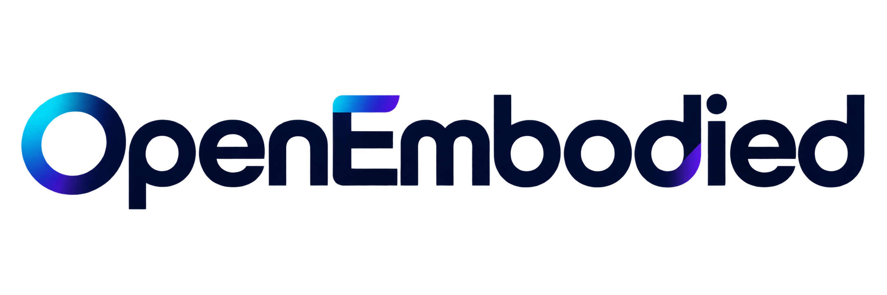

<div align="center">
  

  <p><strong>An evidence-first atlas for Embodied AI.</strong></p>
  <p>Track the frontier · Compare methods · Reproduce what matters</p>
  <p>
    <a href="README_ZH.md">简体中文</a>
    ·
    <a href="#-why-openembodied">Why OpenEmbodied</a>
    ·
    <a href="#-explore">Explore</a>
  </p>
</div>

---

## 🌐 About

Embodied AI moves quickly, but more information does not always produce better understanding. Papers use different datasets, evaluation protocols, hardware, and reporting conventions; repositories often show successful demos without documenting the conditions or failures behind them.

**OpenEmbodied turns scattered resources into structured, comparable, and verifiable knowledge.**

Instead of building another link collection, this project records what a method solves, how it works, what evidence supports it, what it costs to reproduce, and where it stops working.

> [!IMPORTANT]
> OpenEmbodied is in its foundation stage. The standards and first flagship collections are being designed before the repository expands in breadth.

## ✨ Why OpenEmbodied

| Common problem | OpenEmbodied approach |
| --- | --- |
| Long lists of papers with little context | Structured model, benchmark, dataset, simulator, and robot notes |
| Results that are difficult to compare | Dataset, benchmark, metric, and evaluation-protocol context |
| “Open source” without reproducibility details | Explicit code, weights, data, license, compute, and environment status |
| Successful demos without failure analysis | Limitations, failure modes, and unresolved questions |
| Claims without clear provenance | Primary sources, explicit scope, and reproducible context |

## 🧭 Explore

**Catalog:** [Models](models/README.md) · [Benchmarks](benchmarks/README.md)

### 🔭 [Open VLA Landscape](docs/vla-landscape/README.md)

A practical comparison of OpenVLA, SmolVLA, openpi, and GR00T N1.7 across architecture, actions, openness, compute, and evaluation.

### 🦾 [Robot Manipulation Benchmark Map](docs/benchmark-map/README.md)

A guide to what LIBERO, CALVIN, SimplerEnv, RoboTwin 2.0, and RoboDojo measure—and when their results can be compared.

## 🗂️ How the Repository Is Organized

```text
Track the frontier → Understand the work → Verify the result → Choose with context
```

- **Frontier Watch** highlights important new work and explains why it matters.
- **Models & Benchmarks** provide source-backed technical notes on individual systems and evaluation suites.
- **Reproduction Reports** document runnable experiments, results, and failure cases.
- **Documentation** connects individual entries into research landscapes, benchmark maps, and reproduction reports.

## 🤝 Contributing

OpenEmbodied welcomes corrections, primary-source updates, technical notes, benchmark analysis, and reproduction reports.

A useful contribution includes:

- the official source and release date;
- the relevant research area;
- a factual summary and reason for inclusion;
- availability of code, weights, data, and license;
- evaluation or reproduction evidence when available;
- known limitations or unresolved questions.

Contribution templates will be added with the first repository structure release. Until then, open an Issue to propose a resource or correction.

## 🙏 Acknowledgments

OpenEmbodied is inspired by the researchers, engineers, educators, and open-source contributors advancing embodied intelligence.

External papers, code, datasets, and other resources remain the property of their respective owners. Follow each source's license and citation requirements.
