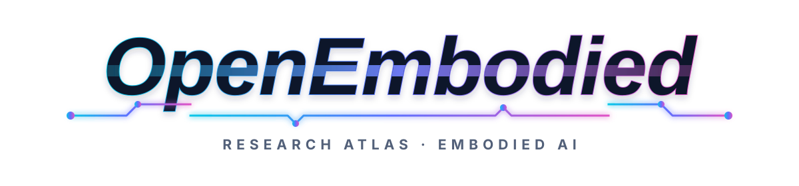

  

  <strong>Mapping embodied intelligence from perception and reasoning to action and real-world deployment.</strong>

  👁️ Perception &nbsp;·&nbsp; 🧠 Reasoning &nbsp;·&nbsp; 🌐 World Models 
  🧭 Navigation &nbsp;·&nbsp; 🦾 Manipulation &nbsp;·&nbsp; 🤖 Deployment

  <a href="README_ZH.md">简体中文</a>
  &nbsp;·&nbsp;
  <a href="#-about">About</a>
  &nbsp;·&nbsp;
  <a href="#-technical-catalog">Technical Catalog</a>
  &nbsp;·&nbsp;
  <a href="#-research-maps">Research Maps</a>
  &nbsp;·&nbsp;
  <a href="#-contributing">Contributing</a>

---

## 🌐 About

OpenEmbodied is a structured research atlas for Embodied AI, tracing the field from perception, reasoning, and world models to navigation, manipulation, and real-world deployment. Instead of collecting isolated links, it organizes primary-source knowledge around the relationships between methods, evaluation systems, and embodied platforms.

- **Explore methods** through focused profiles of model families, core ideas, released resources, and practical use cases.
- **Understand evaluation** through benchmark pages that clarify tasks, embodiments, protocols, metrics, and comparison boundaries.
- **Navigate the field** through research maps that connect models, benchmarks, datasets, simulators, robots, and deployment stacks.

## 🗂️ Technical Catalog

### 🧠 Models & Policies

#### [Vision-Language-Action Models](models/vla/README.md)

Generalist robot policies that connect visual observations and language instructions to actions.

- [OpenVLA / OpenVLA-OFT](models/vla/openvla.md)
- [SmolVLA](models/vla/smolvla.md)
- [π0 / π0-FAST / π0.5](models/vla/openpi.md)
- [NVIDIA Isaac GR00T N1.7](models/vla/gr00t-n1.7.md)

#### [Grasping Models](models/grasping/README.md)

Methods for parallel-gripper perception, dexterous grasp generation, and grasp execution.

- [AnyGrasp](models/grasping/anygrasp.md)
- [UniDexGrasp](models/grasping/unidexgrasp.md)
- [DexGraspNet 2.0](models/grasping/dexgraspnet-2.md)
- [DexGrasp Anything](models/grasping/dexgrasp-anything.md)

### 📏 [Evaluation Benchmarks](benchmarks/README.md)

- [LIBERO](benchmarks/libero.md) — knowledge transfer in lifelong and multitask robot learning.
- [CALVIN](benchmarks/calvin.md) — language-conditioned long-horizon manipulation.
- [SimplerEnv](benchmarks/simplerenv.md) — simulation-to-real evaluation fidelity.
- [RoboTwin 2.0](benchmarks/robotwin-2.md) — scalable bimanual data generation and robustness evaluation.
- [RoboDojo](benchmarks/robodojo.md) — broad generalist-policy evaluation in simulation and on real robots.
- [RoboDyna](benchmarks/robodyna.md) — dynamic physical reasoning and latency-aware manipulation.

## 🧭 Research Maps

### 🔭 Open VLA Landscape

Compare open VLA families across architecture, action generation, adaptation, compute, evaluation, and deployment surfaces.

- [Landscape Overview](docs/vla-landscape/README.md)
- [Model Matrix](docs/vla-landscape/model-matrix.md)
- [Benchmark Notes](docs/vla-landscape/benchmark-notes.md)
- [Primary Sources](docs/vla-landscape/sources.md)

### 🦾 Manipulation Benchmark Map

Understand what manipulation benchmarks measure and when their results can be compared.

- [Benchmark Map Overview](docs/benchmark-map/README.md)
- [Benchmark Matrix](docs/benchmark-map/benchmark-matrix.md)
- [Protocol Guide](docs/benchmark-map/protocol-guide.md)
- [Primary Sources](docs/benchmark-map/sources.md)

## 🛰️ Expanding the Atlas

| Research area | Planned coverage |
| --- | --- |
| **Perception** | 3D vision, grounding, mapping, affordance, and active perception |
| **Embodied Reasoning** | spatial and temporal reasoning, planning, memory, and decision making |
| **World Models** | environment prediction, video-action generation, simulation, and policy improvement |
| **Navigation** | visual-language navigation, exploration, localization, and mobile interaction |
| **Datasets & Simulators** | embodied data, synthetic generation, physics engines, and evaluation environments |
| **Robots & Deployment** | embodiments, interfaces, policy serving, sim-to-real, and real-world systems |

## 🤝 Contributing

OpenEmbodied welcomes corrections, new technical profiles, landscape improvements, benchmark analysis, and implementation experience.

A strong contribution is factual, source-linked, technically scoped, and clear about what is released, what is measured, and what remains uncertain. Open an Issue to propose a new area, resource, or correction.

## 🙏 Acknowledgments

OpenEmbodied is built on the work of researchers, engineers, educators, and open-source communities advancing embodied intelligence.

External papers, code, datasets, images, and other resources remain the property of their respective owners. Follow each source's license and citation requirements.
