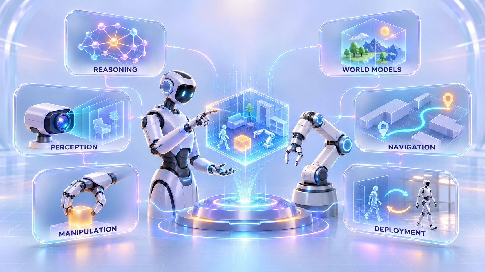

  

  <strong>Models, benchmarks, and research maps for embodied intelligence.</strong>

  <a href="README_ZH.md">简体中文</a>
  &nbsp;·&nbsp;
  <a href="#-overview">🌐 Overview</a>
  &nbsp;·&nbsp;
  <a href="#-research-directions">🧭 Research Directions</a>
  &nbsp;·&nbsp;
  <a href="#-broader-research-scope">🛰️ Broader Research Scope</a>
  &nbsp;·&nbsp;
  <a href="#-contributing">🤝 Contributing</a>

---

## 🌐 Overview

OpenEmbodied is a curated reference for embodied AI research. It organizes model and benchmark profiles by research direction, with comparative analyses of technical choices, evaluation protocols, and published research. The current collection focuses on robotic manipulation; the broader scope is outlined below.

## 🧭 Research Directions

Research directions bring together representative methods, evaluation benchmarks, and comparative analyses.

###  [Embodied Manipulation](manipulation/README.md)

Robot manipulation through learned policies, world-action modeling, agent-based control, grasp generation, and evaluation.

#### [Vision-Language-Action](manipulation/models/vla/README.md)

Robot policies that map visual observations and language instructions to actions.

- [OpenVLA / OpenVLA-OFT](manipulation/models/vla/openvla.md)
- [SmolVLA](manipulation/models/vla/smolvla.md)
- [openpi: π0 / π0-FAST / π0.5](manipulation/models/vla/openpi.md)
- [NVIDIA Isaac GR00T N1.7](manipulation/models/vla/gr00t-n1.7.md)

#### [World Action Models](manipulation/models/wam/README.md)

Joint modeling of world dynamics and robot actions. The approaches differ in whether future observations are generated during execution.

- [Unified World Models](manipulation/models/wam/uwm.md) — coupled video and action diffusion.
- [DreamZero](manipulation/models/wam/dreamzero.md) — video-based world modeling for closed-loop control.
- [Fast-WAM](manipulation/models/wam/fast-wam.md) — video co-training with direct action generation at inference.
- [OpenWAM](manipulation/models/wam/openwam.md) — modular world-action pretraining and the OpenWAM-α policy.

#### [Agent-Based Manipulation](manipulation/agents/README.md)

Closed-loop control systems that combine multimodal reasoning, robot tools, execution feedback, and, in some cases, learned action policies.

- [GPT-6 Astra as an Embodied Policy](manipulation/agents/gpt-as-policy.md) — direct control and π0.5-assisted control.
- [π0.5 + Astra with Selective Intervention](manipulation/agents/pi05-call-astra.md) — learned handoff for recovery.
- [GPT-Policy](manipulation/agents/gpt-policy.md) — in-context robot learning through a constrained tool interface.

#### [Grasping](manipulation/models/grasping/README.md)

Grasp detection for parallel grippers and grasp synthesis for dexterous hands.

- [AnyGrasp](manipulation/models/grasping/anygrasp.md)
- [UniDexGrasp](manipulation/models/grasping/unidexgrasp.md)
- [DexGraspNet 2.0](manipulation/models/grasping/dexgraspnet-2.md)
- [DexGrasp Anything](manipulation/models/grasping/dexgrasp-anything.md)

---

#### [Manipulation Evaluation](manipulation/benchmarks/README.md)

Evaluation suites covering transfer, long-horizon control, sim-to-real evaluation, robustness, and dynamic manipulation.

- [LIBERO](manipulation/benchmarks/libero.md) — lifelong and multitask manipulation across task suites.
- [CALVIN](manipulation/benchmarks/calvin.md) — language-conditioned long-horizon manipulation.
- [SimplerEnv](manipulation/benchmarks/simplerenv.md) — simulation-based evaluation and real-world ranking alignment.
- [RoboTwin 2.0](manipulation/benchmarks/robotwin-2.md) — scalable bimanual data generation and robustness evaluation.
- [RoboDojo](manipulation/benchmarks/robodojo.md) — generalist manipulation policy evaluation in simulation and on real robots.
- [RoboDyna](manipulation/benchmarks/robodyna.md) — dynamic physical reasoning and latency-aware manipulation.

---

## 🛰️ Broader Research Scope

Beyond manipulation, OpenEmbodied's research scope includes other embodied capabilities and the data, simulation, and robotic systems that support them:

| Research area | Scope |
| --- | --- |
| **Perception** | 3D scene understanding, visual grounding, affordance prediction, and active perception |
| **Embodied Reasoning** | spatial reasoning, task planning, memory, and decision making |
| **World Models** | general-purpose dynamics prediction, video generation, and model-based planning beyond manipulation policies |
| **Navigation** | visual-language navigation, localization, mapping, and exploration |
| **Data & Simulation** | embodied datasets, synthetic data generation, simulators, and evaluation environments |
| **Robotic Systems** | robot platforms, policy deployment, and sim-to-real transfer |

## 🤝 Contributing

Contributions to model and benchmark profiles, comparative analyses, and primary-source references are welcome.

Please cite the original papers, official repositories, or project documentation, and distinguish reported results from independently verified results. Open an Issue to propose a topic or report a correction.

## 🙏 Acknowledgments

OpenEmbodied is built on the work of researchers, engineers, educators, and open-source communities advancing embodied intelligence.

External papers, code, datasets, images, and other resources remain the property of their respective owners. Follow each source's license and citation requirements.
