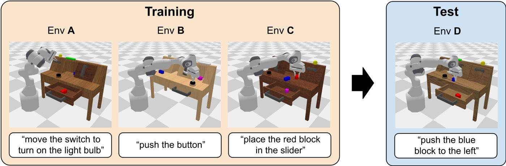

# CALVIN

[简体中文](calvin_ZH.md)

> **Category:** Robot Manipulation Benchmark · [Repository](https://github.com/mees/calvin) · [Project Page](http://calvin.cs.uni-freiburg.de/) · [Paper](https://arxiv.org/abs/2112.03227)

  

<em>CALVIN composes language-conditioned tabletop skills into long-horizon sequences. Image source: <a href="https://github.com/mees/calvin">official repository</a>.</em>

## Technical Summary

- **Primary purpose:** language-conditioned, long-horizon manipulation.
- **Setting:** a Franka arm in a PyBullet tabletop environment.
- **Task organization:** 34 atomic tasks that can be composed into instruction sequences.
- **Representative metric:** average number of consecutive instructions completed in a five-instruction chain.

## Evaluation Objective

CALVIN evaluates more than isolated reach-and-grasp success. A policy must interpret a changing sequence of language goals, preserve relevant context, transition between subtasks, and avoid errors that prevent later goals. This exposes compounding error and temporal composition more clearly than independent one-step trials.

## Data and Evaluation

The dataset contains teleoperated play interactions paired with language annotations for task-relevant segments. The standard long-horizon evaluation samples sequences of five instructions. Reporting commonly includes success at completing at least one, two, three, four, and all five instructions, plus the average completed sequence length.

## Environment and Task Design

The simulated tabletop contains a Franka Panda arm and interactive elements such as drawers, a sliding door, buttons, blocks, and a light switch. The 34 atomic tasks describe state changes in this shared environment. Because tasks start from the state left by the preceding instruction, the policy must both complete the current goal and leave the scene in a usable condition.

The dataset is collected as play rather than as isolated demonstrations for every command. Language annotations identify segments that accomplish task-relevant changes. This makes sequence modeling, relabeling, and learning reusable skills central parts of the benchmark.

## Metric Structure

For a chain of five instructions, evaluation records whether at least 1, 2, 3, 4, or 5 tasks are completed in order. The average completed length summarizes the curve, but the full curve reveals where errors accumulate. A policy that reliably completes the first instruction but rarely reaches the fifth has a different limitation from a policy that fails immediately.

## Reading Results

- Confirm the dataset split and official task-chain evaluation.
- Check whether history, language relabeling, auxiliary data, or pretrained vision-language components are used.
- Atomic-task success and chained success are not interchangeable.
- A strong first-task score with a steep chain-length decline indicates a different failure mode from uniformly low success.

## Research Use

Use CALVIN when language grounding, history, subtask transitions, and compounding error are central. Use an independent-task benchmark instead when the goal is to isolate a single manipulation skill without sequence dependencies.

## References

- [Official repository](https://github.com/mees/calvin)
- [Project page](http://calvin.cs.uni-freiburg.de/)
- [Paper](https://arxiv.org/abs/2112.03227)
