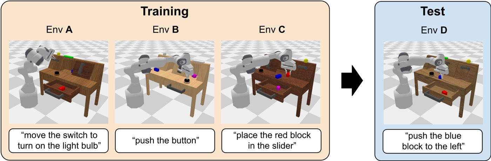

# CALVIN

[English](calvin.md)

> **类别：** Robot Manipulation Benchmark · [Repository](https://github.com/mees/calvin) · [Project Page](http://calvin.cs.uni-freiburg.de/) · [Paper](https://arxiv.org/abs/2112.03227)

  

<em>CALVIN 将 language-conditioned tabletop skills 组合为 long-horizon sequences。图片来源：<a href="https://github.com/mees/calvin">official repository</a>。</em>

## 概览

- **主要目标：** Language-conditioned long-horizon manipulation。
- **环境：** PyBullet tabletop environment 中的 Franka arm。
- **任务组织：** 34 个 atomic tasks，可组合为 instruction sequences。
- **代表性指标：** 五条指令链中连续完成的平均 instruction 数量。

## 为什么重要

CALVIN 不只评估独立的 reach-and-grasp。Policy 需要理解持续变化的 language goals、保留相关 context、在 subtasks 之间转换，并避免早期错误阻断后续目标。因此，它比独立单步 trial 更容易暴露 compounding error 与 temporal composition 问题。

## 数据与评测

Dataset 包含 teleoperated play interactions，以及针对相关片段的 language annotations。标准 long-horizon evaluation 抽取由五条指令组成的 sequence，通常报告至少完成 1、2、3、4、5 条指令的成功率，以及平均完成长度。

## 环境与任务设计

模拟桌面包含 Franka Panda arm，以及 drawer、sliding door、buttons、blocks 和 light switch 等交互元素。34 个 atomic tasks 描述同一共享环境中的 state changes。每个任务从上一条指令结束后的状态继续，因此 policy 不仅要完成当前 goal，还要为后续任务保留可用的场景状态。

Dataset 以 play data 形式采集，而不是为每条 command 独立录制 demonstrations。Language annotations 标注能够完成目标状态变化的片段，使 sequence modeling、relabeling 与 reusable skills 成为 benchmark 的重要组成部分。

## Metric 结构

对于五条指令链，评测记录按顺序至少完成 1 至 5 个任务的比例。平均完成长度可以概括整体曲线，但完整曲线更能展示错误从何处开始累积。只能稳定完成第一条指令，与从一开始就普遍失败，是两种不同的 limitation。

## 结果解读

- 明确 dataset split，并确认使用 official task-chain evaluation。
- 检查 history、language relabeling、auxiliary data 与 pretrained vision-language components。
- Atomic-task success 与 chained success 不能互换。
- 第一条任务成功率高但随 chain length 快速下降，通常反映 transition 或 long-horizon 问题。

## 适用场景

CALVIN 适合研究 language grounding、history、subtask transition 与 compounding error。如果目标只是隔离单一 manipulation skill，应选择 independent-task benchmark。

## 原始来源

- [Official repository](https://github.com/mees/calvin)
- [Project page](http://calvin.cs.uni-freiburg.de/)
- [Paper](https://arxiv.org/abs/2112.03227)
