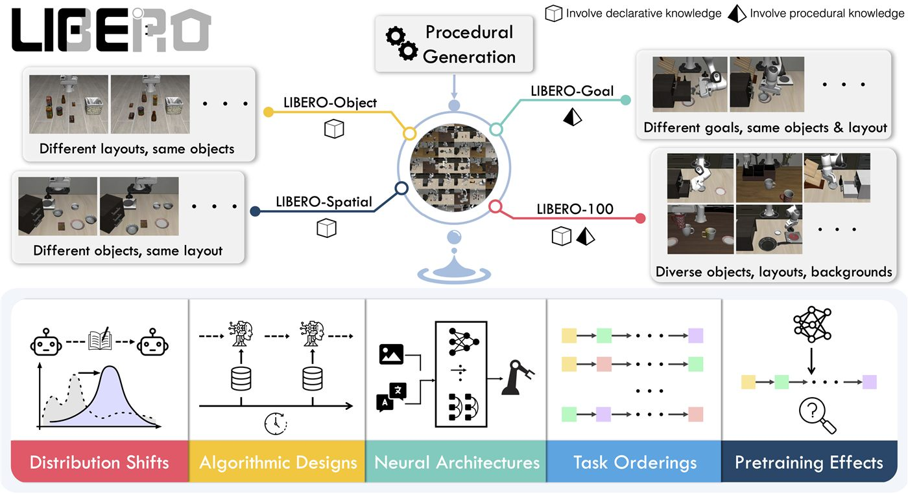

# LIBERO

[简体中文](libero_ZH.md)

> **Category:** Robot Manipulation Benchmark · [Repository](https://github.com/Lifelong-Robot-Learning/LIBERO) · [Project Page](https://libero-project.github.io/) · [Paper](https://arxiv.org/abs/2306.03310)

  

<em>LIBERO studies knowledge transfer across language-conditioned manipulation tasks. Image source: <a href="https://libero-project.github.io/">official project page</a>.</em>

## Snapshot

- **Primary purpose:** knowledge transfer in lifelong and multitask robot learning.
- **Setting:** language-conditioned tabletop manipulation in robosuite/MuJoCo.
- **Task organization:** spatial, object, goal, 10-task, and 90-task suites.
- **Typical output:** task success; lifelong-learning studies additionally measure transfer and forgetting.

## Why It Matters

LIBERO separates several sources of task variation so researchers can ask what knowledge moves between tasks. Spatial tasks change target relations, object tasks emphasize object identity, goal tasks vary the requested behavior, and larger suites test learning across broader task collections.

The benchmark is now also commonly used to evaluate VLA fine-tuning. That use is valid, but it answers a narrower question than the original lifelong-learning design unless tasks are learned sequentially and knowledge transfer is explicitly measured.

## Experimental Design

LIBERO provides procedurally defined manipulation tasks, language descriptions, demonstration datasets, and standardized suites. Policies usually receive visual observations, language, and optionally robot state, then produce continuous control actions. Exact camera inputs, history, control representation, rollout length, and demonstrations per task vary across later model papers and must be stated with results.

## Task Suites

- **LIBERO-Spatial** varies spatial relationships while keeping object and goal semantics comparatively controlled.
- **LIBERO-Object** emphasizes transfer across manipulated objects.
- **LIBERO-Goal** varies the target behavior or goal language.
- **LIBERO-10** provides a compact set of longer-horizon tasks.
- **LIBERO-90** expands coverage to a broad collection of short-horizon tasks.

The suite names are part of the experimental definition. An average across four commonly used suites is useful for VLA evaluation, but it should not be confused with the sequential learning protocols used in the original benchmark.

## Metrics and Research Use

Independent rollouts typically report binary task success. Lifelong-learning experiments additionally care about forward transfer, backward transfer, and forgetting after learning a sequence of tasks. The benchmark is therefore useful for both policy adaptation and continual learning, provided the reported metric matches the claim.

## Reading Results

- Name the exact suite rather than reporting “LIBERO” alone.
- Separate multitask training from sequential lifelong learning.
- Do not infer resistance to forgetting from final average success alone.
- Check whether extra data, observation history, multiple camera views, or benchmark-specific fine-tuning were used.

## Best Fit

Use LIBERO for controlled comparisons of language-conditioned tabletop policies, data-efficient adaptation, or sequential knowledge transfer. It is less suitable for claims about bimanual coordination, real-world deployment, or broad sim-to-real robustness.

## Primary Sources

- [Official repository](https://github.com/Lifelong-Robot-Learning/LIBERO)
- [Project page](https://libero-project.github.io/)
- [Paper](https://arxiv.org/abs/2306.03310)
