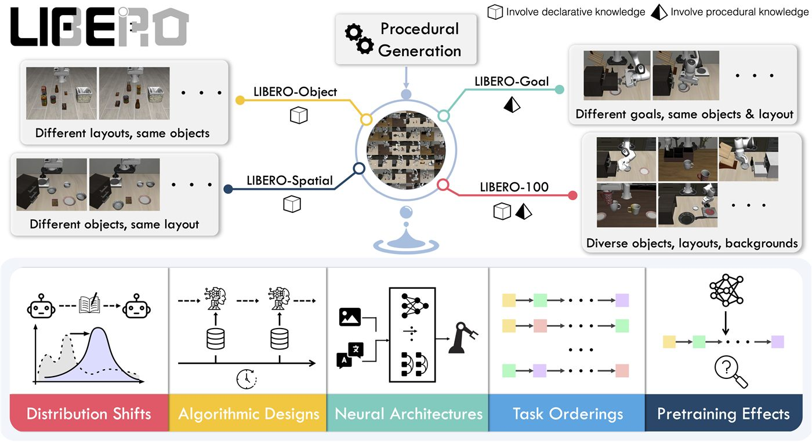

# LIBERO

[English](libero.md)

> **类别：** Robot Manipulation Benchmark · [Repository](https://github.com/Lifelong-Robot-Learning/LIBERO) · [Project Page](https://libero-project.github.io/) · [Paper](https://arxiv.org/abs/2306.03310)

  

<em>LIBERO 研究 language-conditioned manipulation tasks 之间的知识迁移。图片来源：<a href="https://libero-project.github.io/">official project page</a>。</em>

## 概览

- **主要目标：** 研究 lifelong robot learning 与 multitask learning 中的 knowledge transfer。
- **环境：** 基于 robosuite/MuJoCo 的 language-conditioned tabletop manipulation。
- **任务组织：** Spatial、Object、Goal、10-task 与 90-task suites。
- **典型结果：** Task success；lifelong-learning 实验还需要衡量 transfer 与 forgetting。

## 为什么重要

LIBERO 将不同类型的任务变化拆分开，使研究者能够分析知识如何在任务之间迁移。Spatial suite 主要改变空间关系，Object suite 强调 object identity，Goal suite 改变目标行为，更大的 suite 则用于测试更广泛的任务学习。

LIBERO 也被广泛用于 VLA fine-tuning evaluation，但如果没有 sequential learning 与 transfer/forgetting metric，这种用法回答的是 policy adaptation 问题，而不是完整的 lifelong-learning 问题。

## 实验设计

LIBERO 提供程序化 manipulation tasks、language descriptions、demonstration datasets 与标准 suites。Policy 通常输入 visual observations、language 和可选 robot state，并输出 continuous control actions。Camera inputs、history、control representation、rollout horizon 与每个任务使用的 demonstrations 数量，在不同论文中可能不同，必须与结果一同说明。

## Task Suites

- **LIBERO-Spatial：** 改变 spatial relationship，同时尽量控制 object 与 goal semantics。
- **LIBERO-Object：** 强调 manipulated object 之间的迁移。
- **LIBERO-Goal：** 改变目标行为或 goal language。
- **LIBERO-10：** 一组较紧凑的 long-horizon tasks。
- **LIBERO-90：** 扩展到更广泛的 short-horizon task collection。

Suite 名称本身就是实验定义的一部分。VLA 论文常见的四套件平均成功率可以用于 policy evaluation，但不能替代原始 benchmark 中的 sequential learning protocol。

## Metrics 与研究用途

独立 rollout 通常报告 binary task success。Lifelong-learning 实验还关注 forward transfer、backward transfer 与学习任务序列后的 forgetting。因此，LIBERO 可用于 policy adaptation 与 continual learning，但 metric 必须与研究结论匹配。

## 结果解读

- 必须说明具体 suite，不能只写 “LIBERO”。
- 区分 multitask training 与 sequential lifelong learning。
- 不能仅根据最终平均成功率推断 forgetting resistance。
- 检查是否使用额外数据、observation history、多 camera views 或 benchmark-specific fine-tuning。

## 适用场景

LIBERO 适合 language-conditioned tabletop policy、data-efficient adaptation 与 sequential knowledge transfer 的受控比较，不适合直接支撑 bimanual coordination、real-world deployment 或广泛 sim-to-real robustness 结论。

## 原始来源

- [Official repository](https://github.com/Lifelong-Robot-Learning/LIBERO)
- [Project page](https://libero-project.github.io/)
- [Paper](https://arxiv.org/abs/2306.03310)
