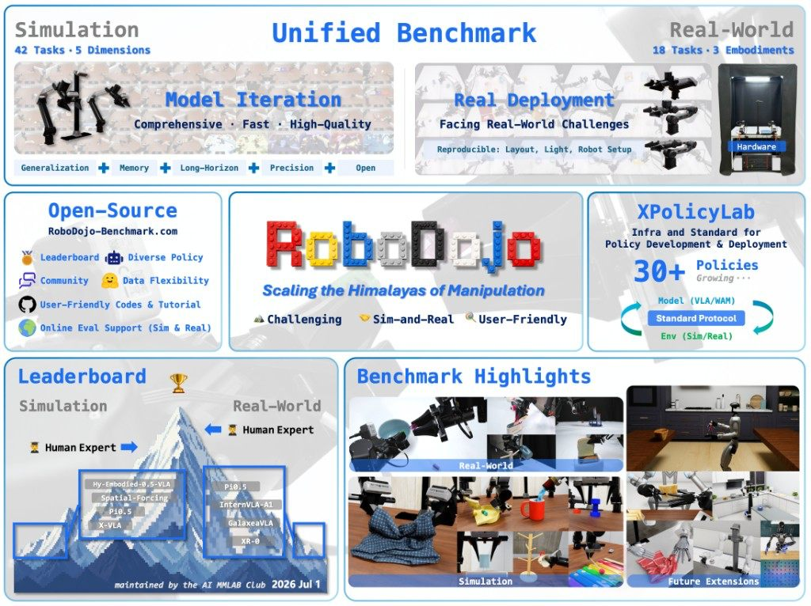

# RoboDojo

[English](robodojo.md)

> **类别：** Robot Manipulation Benchmark · [Repository](https://github.com/RoboDojo-Benchmark/RoboDojo) · [Project Page](https://robodojo-benchmark.com/) · [Paper](https://arxiv.org/abs/2607.04434) · [Leaderboard](https://robodojo-benchmark.com/leaderboard)

  

<em>RoboDojo 统一 simulation 与标准化 real-world evaluation。图片来源：<a href="https://robodojo-benchmark.com/">official project page</a>。</em>

## 概览

- **主要目标：** 全面评估 generalist robot manipulation policies。
- **覆盖范围：** 42 个 simulation tasks 与 18 个 real-world tasks。
- **能力维度：** Generalization、Memory、Precision、Long-Horizon 与 Open-vocabulary instruction following。
- **Policy integration：** XPolicyLab 提供统一的 serving 与 deployment interface。

## 为什么重要

许多 manipulation benchmark 将结果压缩为单一平均成功率。RoboDojo 按能力维度组织高难度任务，并连接 simulation 与标准化 real-world track，更适合定位 generalist policy 的具体 weakness，而不只是给出一个总排名。

## Simulation 与 Real-World Evaluation

Simulation benchmark 使用 Isaac Sim，并支持在不同 task 与 scene 间进行 heterogeneous parallel execution。RoboDojo-RealEval 对 physical testing 的 hardware、scene reset、evaluation protocol 与 deployment interface 进行标准化，并支持 remote evaluation。Real-world track 覆盖三种 bimanual embodiments。

RoboDojo 的公开架构以 evaluation 为核心：policy 通过 XPolicyLab 集成，RoboDojo 负责 environment、task、layout、validation、scoring 与 result artifacts。XPolicyLab 同时支持 RoboTwin，但两个 benchmark 仍然独立。

## Capability Dimensions

- **Generalization：** 改变 objects、layouts 或其他条件，测试超出狭窄设置的迁移能力。
- **Memory：** 要求保留当前 observation 中已经不可见的 task-relevant information。
- **Precision：** 强调精细空间控制与较小 execution tolerance。
- **Long-Horizon：** 组合多个阶段，使早期错误影响后续进度。
- **Open：** 使用更开放的 language 与 task condition，测试固定模板之外的 instruction understanding。

需要分别报告这些维度，因为总体结果相同的两个 policy，实际能力结构可能完全不同。

## Evaluation Architecture

RoboDojo simulator client 运行 environment，并将 observations 发送给 policy server。XPolicyLab 管理 policy adapters 与统一 serving interface，使同一 policy 可以在 RoboDojo simulation 与 real stations 中评测，并减少 policy-side adaptation。Heterogeneous parallel execution 可以同时运行不同任务与场景。

RoboDojo-RealEval 对 physical station、scene reset、deployment interface 与 scoring procedure 进行标准化。它提高了相对于独立实验室 setup 的 reproducibility，但 simulation 与 real-world result 仍应作为不同 track 报告。

## 结果解读

- 先查看 per-dimension results，再查看 aggregate score。
- 区分 simulation 与 real-robot results。
- 记录 checkpoint、XPolicyLab adapter、layout/seed protocol、action interface 与 evaluation track。
- 与 verified leaderboard 比较时使用 official protocol。
- RoboDojo 与 RoboTwin 2.0 共享 policy infrastructure，不代表两者 score 可直接比较。

## 适用场景

RoboDojo 适合诊断 generalist policy 在不同 manipulation capabilities 上的表现，或连接 simulated evaluation 与受控 real-robot protocol。它不是 training dataset release，也不能替代 task-specific data collection。

## 原始来源

- [Official repository](https://github.com/RoboDojo-Benchmark/RoboDojo)
- [Project page](https://robodojo-benchmark.com/)
- [Paper](https://arxiv.org/abs/2607.04434)
- [Leaderboard](https://robodojo-benchmark.com/leaderboard)
- [XPolicyLab](https://github.com/XPolicyLab/XPolicyLab)
