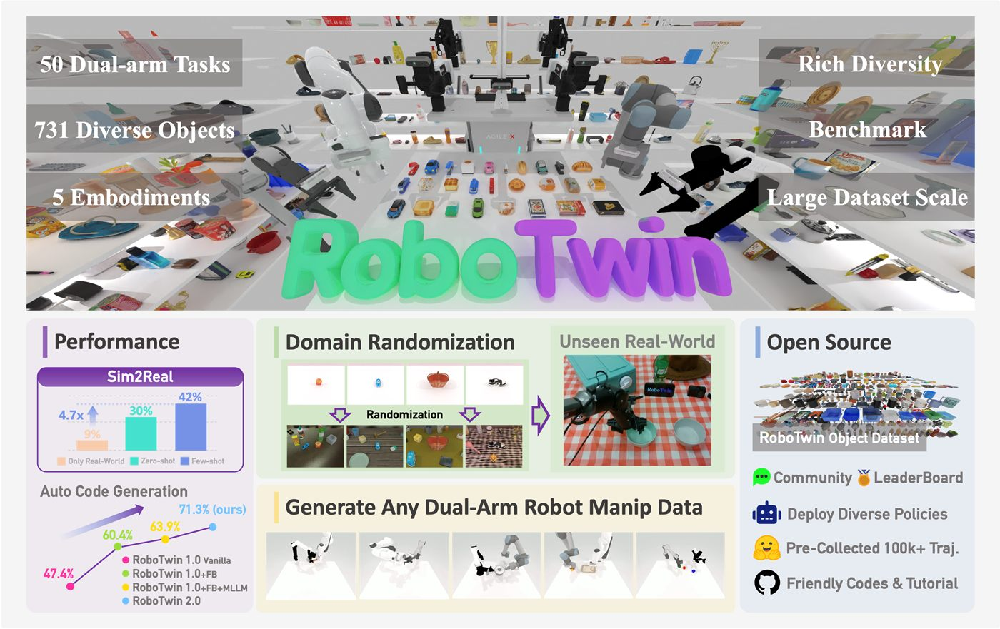

# RoboTwin 2.0

[简体中文](robotwin-2_ZH.md)

> **Category:** Robot Manipulation Benchmark · [Repository](https://github.com/RoboTwin-Platform/RoboTwin) · [Project Page](https://robotwin-platform.github.io/) · [Documentation](https://robotwin-platform.github.io/doc/) · [Paper](https://arxiv.org/abs/2506.18088)

  

<em>RoboTwin 2.0 combines task generation, expert data synthesis, and bimanual policy evaluation. Image source: <a href="https://robotwin-platform.github.io/">official project page</a>.</em>

## Technical Summary

- **Primary purpose:** scalable data generation and robust bimanual manipulation evaluation.
- **Setting:** SAPIEN-based dual-arm simulation with multiple supported robot embodiments.
- **Task organization:** 50 bimanual tasks built around a diverse object collection.
- **Key variation:** clean and domain-randomized evaluation settings.

## Evaluation Objective

RoboTwin 2.0 connects three problems that are often treated separately: authoring manipulation tasks, generating expert demonstrations at scale, and evaluating learned policies under environmental variation. Its focus on dual-arm coordination and diverse objects makes it complementary to single-arm tabletop suites.

## Data and Evaluation

The framework includes programmable task experts, automated task-code generation tools, the RoboTwin Object Dataset, and policy evaluation. The official project describes 50 tasks, 731 objects across 147 categories, and support for five robot embodiments. Domain randomization varies factors such as objects, clutter, lighting, backgrounds, table height, and language instructions.

## System Components

1. **RoboTwin-OD** supplies rigid, articulated, and visually varied assets with semantic and manipulation-relevant annotations.
2. **Task generation** uses a multimodal language model and simulation feedback to help produce executable task programs.
3. **Expert collection** runs task-specific scripted solutions to generate demonstrations at scale.
4. **Policy evaluation** tests learned controllers on standardized dual-arm tasks under controlled scene variations.

These components make RoboTwin both a data-generation framework and an evaluation benchmark. A paper may use only one of the two roles, so “trained on RoboTwin” and “evaluated on RoboTwin” should be stated separately.

## Evaluation Dimensions

The 50 tasks cover coordinated picking, placement, handover, tool use, articulation, stacking, and other dual-arm skills. Clean scenes measure task execution under the standard setup; randomized scenes introduce clutter, illumination, background, table-height, object, and language variation. Multiple robot embodiments are supported by the wider framework, but a result remains tied to the embodiment actually used.

## Reading Results

- Report the exact task set and robot embodiment.
- Keep clean and randomized results separate.
- State whether training uses RoboTwin-generated demonstrations and how much data is used.
- Record scene seeds, episode count, step limits, language variants, and enabled randomizations.
- RoboTwin 2.0 and RoboDojo can share XPolicyLab integration, but they use different tasks and evaluation designs.

## Research Use

Use RoboTwin 2.0 for scalable synthetic demonstrations, bimanual coordination, and robustness to structured domain variation. Use RoboDojo when the primary goal is capability-oriented diagnosis across both simulation and standardized real-robot evaluation.

## References

- [Official repository](https://github.com/RoboTwin-Platform/RoboTwin)
- [Project page](https://robotwin-platform.github.io/)
- [Documentation](https://robotwin-platform.github.io/doc/)
- [Paper](https://arxiv.org/abs/2506.18088)
- [Leaderboard](https://robotwin-platform.github.io/leaderboard/)
