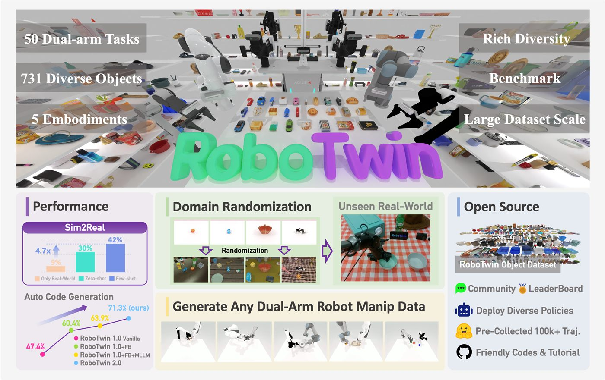

# RoboTwin 2.0

[English](robotwin-2.md)

> **类别：** Robot Manipulation Benchmark · [Repository](https://github.com/RoboTwin-Platform/RoboTwin) · [Project Page](https://robotwin-platform.github.io/) · [Documentation](https://robotwin-platform.github.io/doc/) · [Paper](https://arxiv.org/abs/2506.18088)

  

<em>RoboTwin 2.0 将 task generation、expert data synthesis 与 bimanual policy evaluation 结合起来。图片来源：<a href="https://robotwin-platform.github.io/">official project page</a>。</em>

## 概览

- **主要目标：** Scalable data generation 与 robust bimanual manipulation evaluation。
- **环境：** 基于 SAPIEN 的 dual-arm simulation，支持多种 robot embodiments。
- **任务组织：** 50 个 bimanual tasks 与多样化 object collection。
- **关键变化：** Clean 与 domain-randomized evaluation settings。

## 为什么重要

RoboTwin 2.0 将 task authoring、scale expert demonstration generation 与 environmental variation 下的 learned policy evaluation 连接起来。它对 dual-arm coordination 与 diverse objects 的关注，使其与 single-arm tabletop suites 形成互补。

## 数据与评测

Framework 包括 programmable task experts、automatic task-code generation tools、RoboTwin Object Dataset 与 policy evaluation。官方项目描述了 50 个任务、147 个类别中的 731 个 objects，以及 5 种 robot embodiments。Domain randomization 覆盖 objects、clutter、lighting、background、table height 和 language instructions。

## 系统组成

1. **RoboTwin-OD** 提供 rigid、articulated 与多种视觉外观的 assets，并包含 semantic 和 manipulation-relevant annotations。
2. **Task generation** 使用 multimodal language model 与 simulation feedback 辅助生成 executable task programs。
3. **Expert collection** 运行 task-specific scripted solutions，大规模生成 demonstrations。
4. **Policy evaluation** 在受控 scene variations 下测试 dual-arm tasks。

RoboTwin 同时是 data-generation framework 与 evaluation benchmark。论文可能只使用其中一种功能，因此 “trained on RoboTwin” 与 “evaluated on RoboTwin” 应分开说明。

## Evaluation Dimensions

50 个任务覆盖 coordinated picking、placement、handover、tool use、articulation、stacking 等 dual-arm skills。Clean scene 测试标准设置下的执行能力；randomized scene 引入 clutter、illumination、background、table height、object 与 language variation。更大的 framework 支持多种 embodiments，但每个结果仍与实际使用的 embodiment 绑定。

## 结果解读

- 报告准确的 task set 与 robot embodiment。
- 分开报告 clean 与 randomized results。
- 说明 training 是否使用 RoboTwin-generated demonstrations，以及数据规模。
- 记录 scene seeds、episodes、step limits、language variants 与 randomization configuration。
- RoboTwin 2.0 与 RoboDojo 可以共享 XPolicyLab integration，但任务和 evaluation design 不同。

## 适用场景

RoboTwin 2.0 适合 scalable synthetic demonstrations、bimanual coordination 与 structured domain variation 下的 robustness 研究。若重点是仿真与标准化真机环境中的 capability-oriented diagnosis，则更适合使用 RoboDojo。

## 原始来源

- [Official repository](https://github.com/RoboTwin-Platform/RoboTwin)
- [Project page](https://robotwin-platform.github.io/)
- [Documentation](https://robotwin-platform.github.io/doc/)
- [Paper](https://arxiv.org/abs/2506.18088)
- [Leaderboard](https://robotwin-platform.github.io/leaderboard/)
