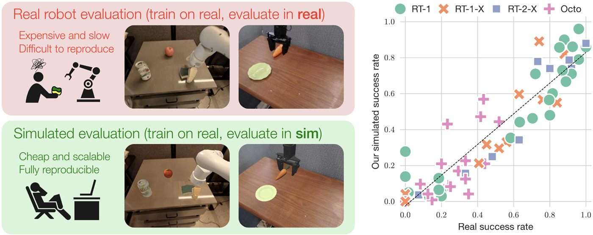

# SimplerEnv

  

<em>SimplerEnv pairs simulated scenes with corresponding real-robot evaluations. Image source: <a href="https://simpler-env.github.io/">official project page</a>.</em>

## Snapshot

- **Primary purpose:** evaluate real-world robot policies in simulation.
- **Setting:** SAPIEN/ManiSkill-based simulated counterparts of common real-robot setups.
- **Representative systems:** Google Robot and WidowX manipulation environments.
- **Key analysis:** agreement between simulated and real-world policy performance.

## Why It Matters

Real-robot evaluation is costly, slow, and difficult to reproduce. SimplerEnv tests whether a controlled simulation can serve as a useful proxy by comparing policies in paired simulated and physical setups. Its central question is not whether a simulator looks realistic in isolation, but whether conclusions drawn from it track real-world results.

## Evaluation Approaches

SimplerEnv supports visual matching, which adjusts simulated appearance toward real observations, and environment-variant aggregation, which evaluates across visual and physical variations. The project analyzes real-to-sim agreement using task success together with correlation and ranking-oriented measures.

## Environments and Policy Interface

The released environments reproduce task families associated with Google Robot and WidowX setups using SAPIEN and ManiSkill foundations. A uniform Gym-style interface lets policy wrappers receive camera observations and robot state, then convert predicted actions into the simulator's control space.

Two complementary strategies address the reality gap:

- **Visual matching** tunes foreground objects, robot appearance, and backgrounds toward recorded real scenes.
- **Variant aggregation** evaluates over multiple plausible visual and physical configurations instead of relying on a single digital twin.

## What the Metrics Mean

Pearson correlation measures linear agreement between simulated and real policy performance, but can behave poorly when the compared policies occupy a narrow score range. SimplerEnv therefore also introduces Mean Maximum Rank Violation, which penalizes simulator rankings that contradict meaningful real-world performance gaps. Neither metric replaces per-task success; they answer whether the simulator supports the same comparative conclusion as the real evaluation.

## Reading Results

- Name the robot, task, environment variant, and policy checkpoint.
- Match observation preprocessing and action transforms to the policy's real setup.
- A high simulated success rate is not evidence of real-world fidelity without paired real results.
- Correlation depends on which policies and tasks are included; it is not a permanent property of the simulator.

## Best Fit

Use SimplerEnv when deciding whether simulation can reduce the cost of evaluating a fixed set of real-robot policies. It is not primarily a training-data benchmark or a claim that simulation fully reproduces real-world behavior.

## Primary Sources

- [Official repository](https://github.com/simpler-env/SimplerEnv)
- [Project page](https://simpler-env.github.io/)
- [Paper](https://arxiv.org/abs/2405.05941)
