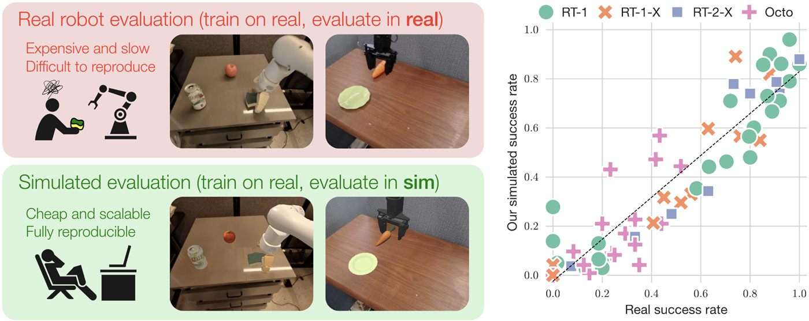

# SimplerEnv

[English](simplerenv.md)

> **类别：** 机器人操作评测基准 · [官方仓库](https://github.com/simpler-env/SimplerEnv) · [项目主页](https://simpler-env.github.io/) · [论文](https://arxiv.org/abs/2405.05941)

  

<em>SimplerEnv 将仿真场景与对应的真机评测配对。图片来源：<a href="https://simpler-env.github.io/">官方项目主页</a>。</em>

## 概览

- **主要目标：** 研究仿真评测在多大程度上反映真实机器人策略的表现。
- **环境：** 基于 SAPIEN/ManiSkill 重建的机器人操作场景。
- **代表性平台：** Google Robot 与 WidowX。
- **核心分析：** 仿真结果与真机结果之间的相关性及策略排序一致性。

## 评测目标

真机评测成本较高，且场景复现存在难度。SimplerEnv 构建与真机任务相对应的仿真场景，检验仿真能否预测不同策略在真实场景中的相对表现。视觉逼真度与评测预测力是不同概念，需要分别考察。

## 评测方法

SimplerEnv 支持视觉匹配，通过调整仿真场景中的前景物体、机器人外观和背景，使渲染观测接近真机图像；也支持对多个环境变体的结果进行汇总。项目通过任务成功率、相关性和策略排序一致性分析仿真与真机结果的关系。

## 环境与策略接口

项目基于 SAPIEN 和 ManiSkill 重建 Google Robot 与 WidowX 的相关任务。统一环境接口向策略提供相机观测与机器人状态，并将预测动作转换为仿真器控制指令。

两种策略用于减小 reality gap：

- **Visual matching：** 调整 foreground objects、robot appearance 与 backgrounds，使其接近真实场景。
- **Variant aggregation：** 在多个合理的视觉与物理配置中评测，而不是依赖单一 digital twin。

## 指标解读

Pearson correlation 衡量 simulated 与 real performance 的线性一致性，但在 policy score 范围很窄时可能不稳定。SimplerEnv 因此提出 Mean Maximum Rank Violation，用于惩罚与 real-world performance gap 相矛盾的 simulator ranking。两类 metric 都不能替代 per-task success，它们回答的是 simulation 是否支持与真实评测相同的比较结论。

## 结果解读

- 说明 robot、task、environment variant 与 policy checkpoint。
- Observation preprocessing 与 action transforms 必须匹配真实系统。
- 没有 paired real result 时，高 simulated success 不能证明 real-world fidelity。
- Correlation 取决于参与比较的 policies 与 tasks，不是 simulator 永久不变的属性。

## 研究用途

SimplerEnv 适合判断 simulation 是否能降低一组固定 real-robot policies 的评测成本。它不是主要用于生成 training data 的 benchmark，也不意味着 simulation 可以完整替代真实世界。

## 参考资料

- [Official repository](https://github.com/simpler-env/SimplerEnv)
- [Project page](https://simpler-env.github.io/)
- [Paper](https://arxiv.org/abs/2405.05941)
