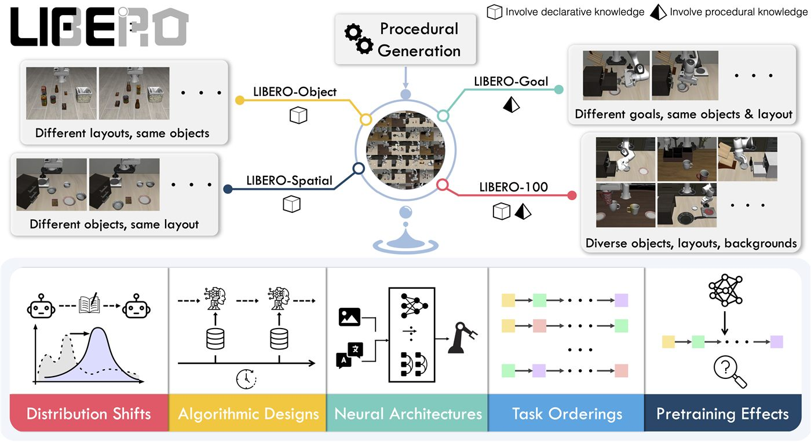

# LIBERO

[English](libero.md)

> **类别：** 机器人操作评测基准 · [官方仓库](https://github.com/Lifelong-Robot-Learning/LIBERO) · [项目主页](https://libero-project.github.io/) · [论文](https://arxiv.org/abs/2306.03310)

  

<em>LIBERO 研究语言条件操作任务之间的知识迁移。图片来源：<a href="https://libero-project.github.io/">官方项目主页</a>。</em>

## 概览

- **主要目标：** 研究终身学习与多任务机器人学习中的知识迁移。
- **环境：** 基于 robosuite/MuJoCo 的语言条件桌面操作。
- **任务组织：** LIBERO-Spatial、LIBERO-Object、LIBERO-Goal、LIBERO-10 与 LIBERO-90。
- **结果指标：** 任务成功率；序列学习实验还需衡量迁移与遗忘。

## 评测目标

LIBERO 通过不同任务套件控制变化来源，以分析知识在任务之间的迁移。Spatial 套件改变空间关系，Object 套件改变操作物体，Goal 套件改变任务目标；LIBERO-100 则提供更大规模的任务集合，其中 LIBERO-90 与 LIBERO-10 分别用于预训练和下游评测。

LIBERO 也常用于 VLA 微调评测。若实验不采用顺序学习协议，也不报告迁移与遗忘指标，其结果主要反映策略适配和任务成功率，不能直接支持终身学习结论。

## 实验设计

LIBERO 提供程序化操作任务、语言描述、示教数据与标准任务套件。策略通常接收视觉观测、语言指令和可选的机器人状态，并输出连续控制动作。不同研究可能采用不同的相机输入、历史观测、动作表示、执行步数及每项任务的示教数量；这些条件需要随结果一同报告。

## 任务套件

- **LIBERO-Spatial：** 改变空间关系，同时尽量保持物体和目标语义一致。
- **LIBERO-Object：** 改变操作物体，考察跨物体迁移。
- **LIBERO-Goal：** 改变任务目标或语言指令。
- **LIBERO-10：** 在原始 LIBERO-100 设置中用于下游终身学习评测。
- **LIBERO-90：** 在原始 LIBERO-100 设置中用于策略预训练。

任务套件是实验定义的一部分。VLA 论文常报告若干套件的平均成功率，但这种策略评测不能替代原始基准的顺序学习协议。

## 评测流程与知识迁移

### 单项任务如何评测

一项任务规定初始场景、语言指令与成功条件。策略接收观测并输出动作，直至满足任务条件或达到执行步数上限；成功率是满足条件的试验占比。初始状态数量与重复执行次数会影响统计结果，因为同一任务在不同物体位置下可能难度不同。相机视角、本体状态、动作频率及每项任务的训练示教数量，也都属于实验定义的一部分。

在原始终身学习设置中，模型按顺序学习多个任务，并在后续学习后重新评估先前任务，才能测量遗忘。若 VLA 模型对一个任务套件同时微调，所得结果属于多任务策略评测，最终平均成功率不能直接证明其持续学习能力。LIBERO-90 与 LIBERO-10 在原始 LIBERO-100 协议中承担不同角色，不宜简单视为两个难度等级。

### 如何理解迁移

前向迁移考察先前任务经验能否帮助学习后续任务；后向迁移考察学习后续任务如何改变先前任务表现，负向变化对应遗忘。这些指标需要明确的任务学习顺序和重复评估，而普通成功率只需要固定策略及测试集。比较研究结果时，应先对齐任务套件、学习顺序、训练方式、观测模态及外部预训练数据。

## 评测指标与研究用途

单次执行通常使用二元任务成功率。终身学习实验还关注前向迁移、后向迁移与顺序学习后的遗忘。LIBERO 可以用于策略适配或持续学习研究，但指标必须与所讨论的问题一致。

## 结果解读

- 必须说明具体 suite，不能只写 “LIBERO”。
- 区分 multitask training 与 sequential lifelong learning。
- 不能仅根据最终平均成功率推断 forgetting resistance。
- 检查是否使用额外数据、observation history、多 camera views 或 benchmark-specific fine-tuning。

## 研究用途

LIBERO 适合 language-conditioned tabletop policy、data-efficient adaptation 与 sequential knowledge transfer 的受控比较，不适合直接支撑 bimanual coordination、real-world deployment 或广泛 sim-to-real robustness 结论。

## 参考资料

- [Official repository](https://github.com/Lifelong-Robot-Learning/LIBERO)
- [Project page](https://libero-project.github.io/)
- [Paper](https://arxiv.org/abs/2306.03310)
