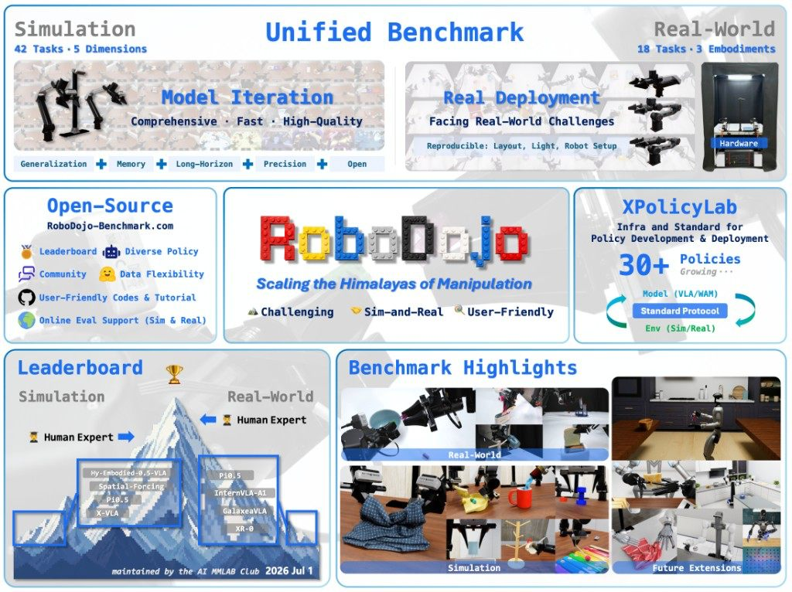

# RoboDojo

[简体中文](robodojo_ZH.md)

> **Category:** Robot Manipulation Benchmark · [Repository](https://github.com/RoboDojo-Benchmark/RoboDojo) · [Project Page](https://robodojo-benchmark.com/) · [Paper](https://arxiv.org/abs/2607.04434) · [Leaderboard](https://robodojo-benchmark.com/leaderboard)

  

<em>RoboDojo unifies simulation and standardized real-world evaluation. Image source: <a href="https://robodojo-benchmark.com/">official project page</a>.</em>

## Technical Summary

- **Primary purpose:** comprehensive evaluation of generalist robot manipulation policies.
- **Coverage:** 42 simulation tasks and 18 real-world tasks.
- **Capability dimensions:** generalization, memory, precision, long-horizon execution, and open-vocabulary instruction following.
- **Policy integration:** XPolicyLab provides a common serving and deployment interface.

## Evaluation Objective

Many manipulation benchmarks compress performance into one task-average success rate. RoboDojo instead groups challenging tasks by the capability they are intended to probe and connects simulation with a standardized real-world evaluation track. This makes it useful for finding where a generalist policy fails rather than only assigning it a single rank.

## Simulation and Real-World Evaluation

The simulation benchmark uses Isaac Sim and supports heterogeneous parallel execution across tasks and scenes. RoboDojo-RealEval standardizes hardware, resets, evaluation protocol, and deployment interfaces for physical testing, including remote evaluation. The real-world track covers three bimanual embodiments.

RoboDojo is evaluation-only in its released architecture: policies are integrated through XPolicyLab, while RoboDojo owns the environments, tasks, layouts, validation, scoring, and result artifacts. XPolicyLab also supports RoboTwin, but the two benchmarks remain distinct.

## Capability Dimensions

- **Generalization** changes objects, layouts, or other task conditions to test transfer beyond a narrow setup.
- **Memory** requires retaining task-relevant information that is no longer directly visible.
- **Precision** stresses fine spatial control and small execution tolerances.
- **Long-Horizon** composes multiple stages so early errors affect later progress.
- **Open** uses more open-ended language and task conditions to test instruction understanding beyond fixed templates.

Reporting these dimensions separately is important: two policies with the same overall result may have very different operational strengths.

## Evaluation Architecture

RoboDojo's simulator client runs environments and sends observations to a policy server. XPolicyLab owns policy adapters and exposes a shared serving interface, allowing the same integrated policy to be evaluated across RoboDojo simulation and real stations with limited policy-side changes. Heterogeneous parallel execution can run different tasks and scenes concurrently.

RoboDojo-RealEval standardizes the physical station, scene reset, deployment interface, and scoring procedure. This improves reproducibility relative to independent lab setups, while still requiring simulation and real-world results to be reported as separate tracks.

## Reading Results

- Inspect per-dimension results before the aggregate score.
- Distinguish simulation results from real-robot results.
- Record the submitted checkpoint, XPolicyLab adapter, layout/seed protocol, action interface, and evaluation track.
- Use the official protocol for comparisons with verified leaderboard entries.
- Do not treat RoboDojo and RoboTwin 2.0 scores as comparable merely because they share policy infrastructure.

## Following an Evaluation Episode

An evaluation begins with a chosen task, scene layout, robot embodiment, and initial state. The benchmark client sends the policy an observation through the XPolicyLab adapter, receives an action in the required interface, advances the simulator or physical station, and repeats until the task succeeds or terminates. The benchmark controls the task definition and scoring; the adapter controls how a particular policy's observations and actions are translated. A policy that fails because its camera keys or action ordering are mismatched has not been evaluated under the intended interface.

The five capability dimensions should be examined separately. A memory task may require information that is no longer visible, whereas a precision task stresses small pose errors and contact tolerances. Long-horizon tasks expose cumulative failures even if each substep is individually plausible. Open-instruction tasks test language generalization rather than only template recognition. The aggregate score summarizes these different demands and can hide concentrated failure in one dimension. Real-world results additionally depend on standardized hardware resets and the remote deployment protocol, so they belong to a separate evidence track from simulation.

## Research Use

Use RoboDojo to diagnose a generalist policy across distinct manipulation capabilities or to connect simulated evaluation with a controlled real-robot protocol. It is not a training dataset release or a substitute for task-specific data collection.

## References

- [Official repository](https://github.com/RoboDojo-Benchmark/RoboDojo)
- [Project page](https://robodojo-benchmark.com/)
- [Paper](https://arxiv.org/abs/2607.04434)
- [Leaderboard](https://robodojo-benchmark.com/leaderboard)
- [XPolicyLab](https://github.com/XPolicyLab/XPolicyLab)
