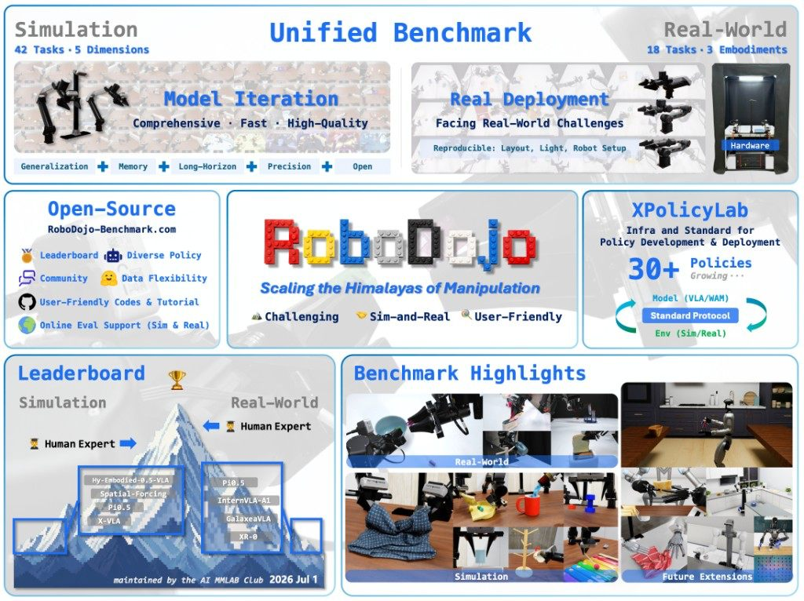

# RoboDojo

[English](robodojo.md)

> **类别：** 机器人操作评测基准 · [官方仓库](https://github.com/RoboDojo-Benchmark/RoboDojo) · [项目主页](https://robodojo-benchmark.com/) · [论文](https://arxiv.org/abs/2607.04434) · [排行榜](https://robodojo-benchmark.com/leaderboard)

  

<em>RoboDojo 结合仿真与标准化真机评测。图片来源：<a href="https://robodojo-benchmark.com/">官方项目主页</a>。</em>

## 概览

- **主要目标：** 按能力维度评估通用机器人操作策略。
- **覆盖范围：** 官方资料列出 42 项仿真任务和 18 项真机任务。
- **能力维度：** 泛化、记忆、精细控制、长程操作与开放词汇指令执行。
- **策略接入：** 通过 XPolicyLab 连接策略服务与评测环境。

## 评测目标

RoboDojo 按能力维度组织任务，并分别提供仿真与真机评测。除总体成功率外，分维度结果可用于分析策略在泛化、记忆、精细控制及长程任务中的表现差异。

## 仿真与真机评测

仿真评测基于 Isaac Sim，支持不同任务与场景的异构并行执行。RoboDojo-RealEval 统一真机评测的硬件、场景重置、评测协议与部署接口，并支持远程评测。真机赛道覆盖三种双臂机器人形态。

RoboDojo 的公开架构围绕评测设计：策略通过 XPolicyLab 接入，RoboDojo 管理环境、任务、场景布局、验证、评分与结果文件。XPolicyLab 同时支持 RoboTwin，但两项评测基准各自独立。

## 能力维度

- **Generalization：** 改变 objects、layouts 或其他条件，测试超出狭窄设置的迁移能力。
- **Memory：** 要求保留当前 observation 中已经不可见的 task-relevant information。
- **Precision：** 强调精细空间控制与较小 execution tolerance。
- **Long-Horizon：** 组合多个阶段，使早期错误影响后续进度。
- **Open：** 使用更开放的 language 与 task condition，测试固定模板之外的 instruction understanding。

需要分别报告这些维度，因为总体结果相同的两个 policy，实际能力结构可能完全不同。

## 评测体系

RoboDojo 仿真客户端运行环境，并将观测发送给策略服务。XPolicyLab 管理策略适配器和统一的服务接口，使同一策略能够在仿真及真机工作站接受评测，减少策略侧的适配工作。异构并行执行可同时运行不同任务与场景。

RoboDojo-RealEval 统一真机工作站、场景重置、部署接口和评分流程，以提高实验可复现性。仿真与真机结果应按不同赛道分别报告。

## 结果解读

- 先查看 per-dimension results，再查看 aggregate score。
- 区分仿真结果与真机结果。
- 记录 checkpoint、XPolicyLab adapter、layout/seed protocol、action interface 与 evaluation track。
- 与经过核验的排行榜结果比较时，使用官方评测协议。
- RoboDojo 与 RoboTwin 2.0 共用部分策略基础设施，但分数不可直接比较。

## 一次评测如何进行

评测先确定任务、场景布局、机器人形态与初始状态。基准客户端通过 XPolicyLab 适配器向策略发送观测，接收符合接口规定的动作，再推进仿真或真机环境，直至任务成功或终止。任务定义和评分由基准负责，策略适配器则负责转换特定模型的观测与动作。若相机字段或动作顺序不匹配，策略尚未在预期接口下接受有效评测。

五个能力维度需要分别阅读。记忆任务可能要求保留当前不可见的信息；精细控制任务考验较小的位姿误差和接触容差。长程任务会放大各阶段误差，开放指令任务则检验超出固定模板的语言理解。综合分数汇总这些不同要求，可能掩盖某一维度的集中失效。真机结果还依赖标准化硬件重置和远程部署协议，应与仿真结果分开呈现。

## 研究用途

RoboDojo 可用于分析通用策略在不同操作能力上的表现，并连接仿真评测与受控真机评测。该项目的主要定位是评测框架，任务专用训练数据仍需按相应的数据来源获取。

## 参考资料

- [Official repository](https://github.com/RoboDojo-Benchmark/RoboDojo)
- [Project page](https://robodojo-benchmark.com/)
- [Paper](https://arxiv.org/abs/2607.04434)
- [Leaderboard](https://robodojo-benchmark.com/leaderboard)
- [XPolicyLab](https://github.com/XPolicyLab/XPolicyLab)
