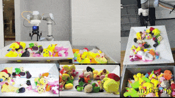

# AnyGrasp

[简体中文](anygrasp_ZH.md) · [Grasping models](README.md)

> Parallel-gripper grasp detection and tracking from point clouds · [Project](https://graspnet.net/anygrasp.html) · [SDK](https://github.com/graspnet/anygrasp_sdk) · [Paper](https://arxiv.org/abs/2212.08333)

  

*Official project demonstration.*

## Technical Summary

- **Problem:** Detect stable 6-DoF grasp poses and track them over time in cluttered or dynamic scenes.
- **End effector:** Parallel gripper.
- **Observation:** Point clouds derived from depth sensing, optionally cropped or masked for a target region.
- **Output:** Grasp pose, width, score, and tracked candidates for downstream motion planning.

## Technical Contribution

Many grasp detectors treat each frame independently. AnyGrasp joins spatial grasp perception with temporal correspondence, so a robot can preserve stable candidates while the camera, objects, or robot move. The system targets practical throughput and has demonstrations spanning clutter removal, deformable objects, transparent objects, and moving targets.

## Technical Shape

The spatial component builds on dense graspability reasoning from the GraspNet and Graspness / GSNet line. Candidate generation is paired with objectness filtering and model-free collision checking. The temporal component associates grasps across consecutive observations, reducing pose jitter and avoiding a complete restart at every frame.

The released SDK exposes options for dense prediction, object-mask filtering, and collision detection. Dense mode trades additional memory and latency for more candidates and is intended for special cases rather than the default path.

## Detection and Robot Integration

### Detection and Temporal Tracking

AnyGrasp takes depth-derived geometry and predicts candidate parallel-gripper poses in six degrees of freedom, together with gripper width and a confidence score. The score is useful for ranking candidates, but it is not a calibrated probability that the complete robot task will succeed. A candidate still needs enough free space for the gripper fingers and for the approach motion. The SDK's collision option evaluates local geometric interference; it does not replace robot-arm collision checking or inverse kinematics.

Temporal tracking links candidates across successive observations. This is relevant when a camera moves or the target changes position: independent framewise detections can jump between similar grasp poses and produce unstable commands. A tracked candidate provides continuity, but the control system must still decide when an estimate is stale, when to re-detect, and when the target has moved outside the reachable workspace. Dense prediction increases candidate coverage at a cost in memory and processing time.

### Integration Sequence

A typical integration starts with depth calibration and a point cloud in a known camera frame. The grasp estimator returns poses in that frame; the robot stack transforms them into the base frame, rejects unreachable or colliding choices, plans an approach, closes the gripper, and verifies lift or task completion. Object masks can restrict predictions to a selected target in a crowded scene. Evaluation should distinguish detector recall, stable tracking, grasp execution success, and end-to-end task success rather than reporting them as one metric.

## Deployment Boundary

AnyGrasp is a perception component, not a complete pick-and-place policy. A working robot system still needs calibrated RGB-D sensing, point-cloud preprocessing, robot–camera transforms, candidate selection, inverse kinematics, motion planning, gripper control, and failure recovery.

The current SDK documentation lists Python 3.6–3.14, PyTorch 1.7.1+, CUDA 11.x/12.x/13.x, and MinkowskiEngine 0.5.4. The supported combination still depends on the target GPU, operating system, and compiled extensions; the [official installation instructions](https://github.com/graspnet/anygrasp_sdk#installation) define the current setup.

## Availability and License Boundary

The official repository provides SDK wrappers and examples, while use of the core library requires license registration. The SDK replaced its previous license tool in July 2026; existing instructions based on the older `lib_cxx.so` or `license_checker` tools do not apply to the updated release. The [current registration guide](https://github.com/graspnet/anygrasp_sdk/tree/main/license_registration) should be consulted before installation or redistribution.

## References

- [Official project page](https://graspnet.net/anygrasp.html)
- [Official AnyGrasp SDK](https://github.com/graspnet/anygrasp_sdk)
- [AnyGrasp paper](https://arxiv.org/abs/2212.08333)
- [GraspNet project](https://graspnet.net/)
