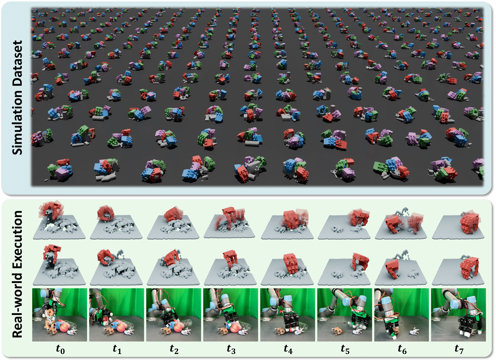

# DexGraspNet 2.0

[简体中文](dexgraspnet-2_ZH.md) · [Grasping models](README.md)

> Generative dexterous grasping in large-scale synthetic cluttered scenes · [Code](https://github.com/PKU-EPIC/DexGraspNet2) · [Paper](https://openreview.net/forum?id=885c47df6263f6be3a883d6b1bcd3e55048d7f2d)

  

*Image source: official project repository.*

## Technical Summary

- **Problem:** Generate dexterous-hand grasps directly in cluttered scenes rather than treating every object in isolation.
- **Input:** Scene point clouds with object and neighborhood geometry.
- **Output:** Collision-aware grasp poses for a dexterous hand.
- **Venue:** CoRL 2024.

## From Object-Level Data to Cluttered Scenes

The original DexGraspNet scales stable grasp synthesis for isolated objects. DexGraspNet 2.0 extends the setting to synthetic cluttered scenes, where a useful grasp must account for the target geometry and nearby obstacles. This shifts the problem from object-only pose generation toward scene-conditioned grasping.

The method uses a generative model conditioned on local scene features. The accompanying pipeline includes synthetic scene construction, signed-distance tooling, grasp generation, and evaluation. This makes the work relevant both as a model and as infrastructure for producing scene-level dexterous-grasp data.

## Evaluation Boundary

Results depend on scene generation, target selection, collision geometry, hand model, simulator validation, and the definition of grasp success. Object-level benchmarks and cluttered-scene results answer different questions and should not be merged into one ranking.

The paper reports real-world experiments, but transferring a generated pose still requires perception calibration, hand–object registration, approach planning, controller design, and hardware-specific contact handling.

## Scene-Level Method and Execution

### Scene-Conditioned Grasp Generation

A dexterous grasp is not only a palm pose: it also specifies the articulated finger configuration and the contacts that configuration can establish. In an isolated-object dataset, the model can reason mostly about one object's surface. In clutter, a pose that is valid for the target may collide with another object, the table, or the hand's approach path. DexGraspNet 2.0 therefore uses scene geometry as part of the condition for grasp synthesis. The target object, surrounding objects, and hand geometry must be expressed in consistent coordinates before a candidate can be evaluated.

The generative stage proposes hand configurations from point-cloud features. Geometric and physical checks then distinguish plausible poses from executable grasps: penetration, target contact, object displacement, and grasp stability are different tests. A collision-free pose at the end of an approach does not prove that the hand can reach it from its starting state. The paper's synthetic-scene generation and signed-distance components provide training and filtering infrastructure for this harder scene-level problem.

### From a Prediction to Robot Execution

For deployment, the perception system must segment or otherwise identify the target and produce a point cloud in the frame expected by the generator. Candidate hand poses are transformed into robot coordinates, checked against the complete scene, and passed to an approach planner or controller. The final grasp must be assessed after finger closure and lift, because contacts change as the object moves. When reading reported results, separate generated-pose validity, simulated grasp success, and real-robot task completion; each measures a different stage of the pipeline.

## Reproduction Notes

The official setup targets Ubuntu 20.04, Python 3.8, CUDA 11.7, PyTorch 2.0.1, PyTorch3D, TorchSDF, and additional SDF tooling. These tightly coupled compiled dependencies make environment reproduction a first-class part of the experiment.

## References

- [Official repository](https://github.com/PKU-EPIC/DexGraspNet2)
- [CoRL 2024 paper](https://openreview.net/forum?id=885c47df6263f6be3a883d6b1bcd3e55048d7f2d)
- [DexGraspNet project](https://pku-epic.github.io/DexGraspNet/)
