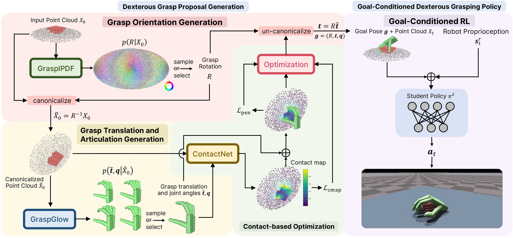

# UniDexGrasp

[简体中文](unidexgrasp_ZH.md) · [Grasping models](README.md)

> Universal dexterous grasping through diverse proposal generation and goal-conditioned execution · [Project](https://pku-epic.github.io/UniDexGrasp/) · [Code](https://github.com/PKU-EPIC/UniDexGrasp) · [Paper](https://arxiv.org/abs/2303.00938)

  

*Image source: official project repository.*

## Technical Summary

- **Problem:** Grasp and lift seen and unseen tabletop objects with a high-DoF dexterous hand.
- **Input:** Realistic object point-cloud observations and robot state during execution.
- **Output:** Diverse target grasp poses followed by a policy that executes a selected target.
- **Venue:** CVPR 2023.

## Two-Stage Design

UniDexGrasp separates the problem into grasp proposal generation and grasp execution. The proposal model conditions on an object point cloud and factorizes rotation from translation and hand articulation, allowing it to sample diverse targets. The execution stage replaces conventional motion planning with a goal-conditioned policy because dexterous contact and articulation make direct planning difficult.

The policy-learning pipeline uses state canonicalization, object curriculum, and teacher–student distillation to train with privileged simulation information while deploying from realistic observations. This distinction matters: a plausible static pose does not by itself guarantee that a hand can approach, establish contact, lift, and recover from errors.

## Proposal, Execution, and Evaluation

### Why Proposal and Execution Are Separate

The proposal model answers a geometric question: which hand configurations could grasp the observed object? A dexterous hand has many joint degrees of freedom, and one object can admit multiple stable contacts. Sampling diverse targets preserves these alternatives instead of committing to a single pose. The execution policy answers a dynamical question: how should the hand move from its current state to one selected target while establishing and maintaining contact? It observes feedback during the maneuver, so it can react to deviations that a static pose generator cannot represent.

The paper uses a factorized pose-generation design because global hand rotation, translation, and articulation have different geometric roles. Its goal-conditioned policy is trained in simulation, where object and hand state can be measured precisely. Canonicalization reduces irrelevant pose variation; curriculum changes the training distribution as the policy improves; teacher–student distillation transfers behavior from privileged training observations toward the observations available during deployment. These are parts of the execution system, not interchangeable grasp-generation techniques.

### Interpreting Results

A useful evaluation records whether the proposal contains a viable grasp, whether the selected proposal is reachable, and whether the execution policy actually lifts the object. A failure at any stage can lower end-to-end success. Object-level generalization also depends on the seen/unseen split and on whether the object point cloud is complete or partially occluded. For a new hand or camera, the hand kinematics, point-cloud frame, contact model, and observation mapping must be adapted before published results can be compared.

## Data and Evaluation

The work builds on a large synthetic dexterous-grasp collection and evaluates generalization across many object instances, including unseen objects. Reported success depends on the proposal generator, selected target, simulator setup, policy observations, and execution criterion; pose-generation scores and end-to-end lift success should therefore be reported separately.

## Reproduction Boundary

The official repository separates `dexgrasp_generation` and `dexgrasp_policy`, reflecting the two-stage design. It is a research stack rather than a packaged robot SDK, and its simulation, CUDA, point-cloud, and reinforcement-learning dependencies require careful version alignment.

The repository states that the work and dataset use CC BY-NC 4.0. The non-commercial restriction should be reviewed before downstream deployment or redistribution.

## References

- [Official project page](https://pku-epic.github.io/UniDexGrasp/)
- [Official repository](https://github.com/PKU-EPIC/UniDexGrasp)
- [CVPR 2023 paper](https://arxiv.org/abs/2303.00938)
- [DexGraspNet foundation](https://pku-epic.github.io/DexGraspNet/)
