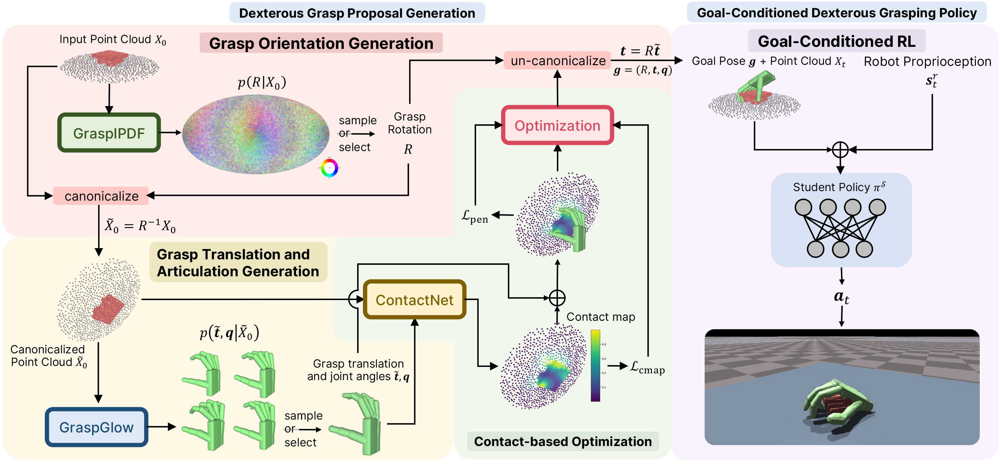

# UniDexGrasp

[English](unidexgrasp.md) · [Grasping Models](README_ZH.md)

> 结合多样化候选姿态生成与目标条件控制的灵巧手抓取方法 · [项目主页](https://pku-epic.github.io/UniDexGrasp/) · [代码仓库](https://github.com/PKU-EPIC/UniDexGrasp) · [论文](https://arxiv.org/abs/2303.00938)

  

*图片来源：官方项目仓库。*

## 概览

- **研究问题：** 使用高自由度灵巧手抓取并抬升桌面场景中已见和未见的物体。
- **输入：** 物体点云；执行阶段还使用机器人状态。
- **输出：** 多样化目标抓取姿态，以及执行选定姿态的控制策略。
- **发表信息：** CVPR 2023。

## 两阶段方法设计

UniDexGrasp 将问题分为候选抓取生成与抓取执行两个阶段。候选生成模型以物体点云为条件，分别建模手部的旋转、平移和关节配置，以采样多种目标姿态。执行阶段使用目标条件策略，使灵巧手从初始状态运动到选定的抓取姿态并完成抬升。

策略训练包含状态规范化、物体课程学习与教师—学生蒸馏。训练阶段可以利用仿真中的额外状态信息，部署阶段则依赖可获得的观测。静态姿态的物理可行性与完整执行成功率属于不同指标：后者还涉及接近、接触、抬升和失败恢复。

## 候选生成、执行与评估

### 为何拆分候选生成与动作执行

候选生成回答几何问题：针对观测到的物体，哪些手部构型可能形成抓取？灵巧手具有较高的关节自由度，同一物体通常存在多种可行接触。对多样候选进行采样，可以保留这些选择。执行策略则回答动态问题：如何从当前手部状态移动到选定目标，并在运动中建立和维持接触？执行阶段持续接收反馈，可以处理静态姿态无法表达的轨迹偏差。

论文将手部整体旋转、平移及关节构型分开建模，因为三者承担不同的几何作用。目标条件策略在仿真中训练，训练时可使用精确的物体与手部状态。状态规范化减少与任务无关的姿态变化；课程学习调整训练任务分布；教师—学生蒸馏将利用仿真特权信息得到的行为迁移至部署时可获得的观测。这些机制服务于执行阶段，不能与抓取候选生成混为一谈。

### 如何解读结果

评估时可分别记录：候选集合是否包含可行抓取、选定目标是否可达，以及执行策略是否完成抬升。任一环节失败都可能降低端到端成功率。对未见物体的泛化还受数据划分、点云遮挡和相机视角影响。接入新的手部或相机时，需要重新匹配运动学、点云坐标、接触模型及观测接口。

## 数据与评估

该工作基于大规模合成灵巧手抓取数据，并评估对未见物体的泛化能力。最终执行成功率受到候选生成、目标选择、仿真设置、策略观测和成功判据共同影响，因此姿态生成质量与端到端抬升成功率需要分别解读。

## 复现边界

官方仓库的 `dexgrasp_generation` 和 `dexgrasp_policy` 对应两个阶段。公开实现是研究代码，并非完整机器人 SDK；仿真、CUDA、点云处理与强化学习依赖需要按仓库说明配置。

官方仓库说明相关工作与数据集采用 CC BY-NC 4.0；商业部署或再分发需核对其非商业用途限制。

## 参考资料

- [Official project page](https://pku-epic.github.io/UniDexGrasp/)
- [Official repository](https://github.com/PKU-EPIC/UniDexGrasp)
- [CVPR 2023 paper](https://arxiv.org/abs/2303.00938)
- [DexGraspNet foundation](https://pku-epic.github.io/DexGraspNet/)
