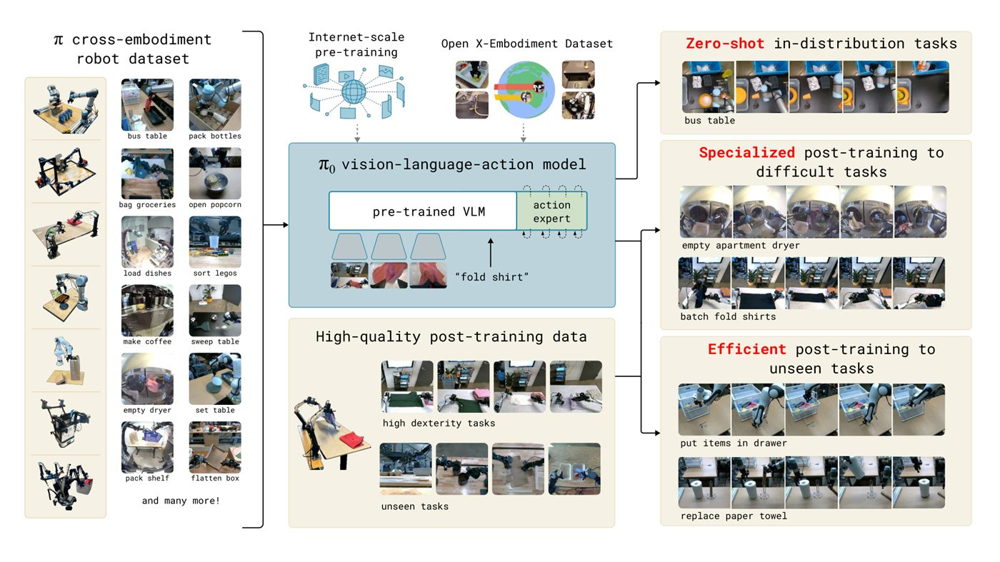

# openpi: π0 / π0-FAST / π0.5

[简体中文](openpi_ZH.md)

> **Category:** Vision-Language-Action Model · [Repository](https://github.com/Physical-Intelligence/openpi) · [π0](https://www.pi.website/blog/pi0) · [π0.5](https://www.pi.website/blog/pi05) · [Paper](https://arxiv.org/abs/2410.24164)

<p align="center">
  
</p>

<p align="center"><em>π0 model, data, and adaptation overview. Image source: <a href="https://arxiv.org/abs/2410.24164">official paper</a>.</em></p>

## Technical Summary

- **Role in the landscape:** an official implementation and release surface for Physical Intelligence robot-policy models.
- **Variants:** π0, π0-FAST, and π0.5.
- **Action generation:** flow matching for π0 and the currently supported π0.5 head; autoregressive action tokens for π0-FAST.

## Technical Contribution

openpi is the official codebase, while π0, π0-FAST, and π0.5 are distinct model variants with their own checkpoints. The repository makes architectural alternatives visible within one model family and publishes both base checkpoints and several task/robot-specific expert checkpoints. It also exposes data conversion, normalization, training, policy serving, and robot/simulation examples, which makes system boundaries easier to inspect.

## Model Family

- **π0** combines a pretrained vision-language model with a flow-matching action expert for continuous control.
- **π0-FAST** represents actions with FAST tokens and predicts them autoregressively, making action generation closer to language-token modeling.
- **π0.5** extends the generalist-policy line with a stronger open-world formulation; the released openpi implementation uses a continuous action expert for supported checkpoints.

These names describe different model and action-generation choices. A result should name the exact checkpoint rather than use “openpi” as if it were a single policy.

## Data and Adaptation Path

The official materials describe pretraining on a mixture of Internet-scale vision-language knowledge, open robot datasets, and Physical Intelligence's multi-robot data. The public repository supports converting target data into a LeRobot-style representation, computing normalization statistics, defining a robot-specific configuration, and fine-tuning with LoRA or full parameters depending on the recipe.

For deployment, a policy process can serve actions over WebSocket while a separate robot or simulator client supplies observations. This boundary is useful when the robot machine cannot host the full accelerator environment.

## What Is Available

- Apache-2.0 repository code, with additional upstream license notices including Gemma-related terms.
- π0, π0-FAST, and π0.5 base checkpoints described as pretrained on more than 10k hours of robot data.
- expert checkpoints for DROID, ALOHA, and LIBERO use cases.
- JAX-centered training plus published PyTorch support.
- LeRobot-format data conversion, fine-tuning, local inference, and WebSocket remote serving.
- Docker and `uv` installation paths.

## Published Requirements

The official repository estimates, for a single GPU:

- inference: more than 8 GB GPU memory;
- LoRA fine-tuning: more than 22.5 GB;
- full fine-tuning: more than 70 GB;
- tested OS: Ubuntu 22.04, with other operating systems currently unsupported.

These are project estimates and have not been reproduced by OpenEmbodied.

## Training Workflow

The commands below follow the official JAX-based π0.5 + LIBERO example. Run them **inside a clone of the upstream openpi repository**, on a supported Ubuntu GPU host. The example config `pi05_libero` points to an existing converted LIBERO dataset; a custom robot dataset requires its own data and training configs.

1. Clone the repository with submodules and install its pinned environment:

   ```bash
   git clone --recurse-submodules https://github.com/Physical-Intelligence/openpi.git
   cd openpi
   GIT_LFS_SKIP_SMUDGE=1 uv sync
   GIT_LFS_SKIP_SMUDGE=1 uv pip install -e .
   ```

2. For a custom dataset, convert episodes to the LeRobot format. The upstream `examples/libero/convert_libero_data_to_lerobot.py` is a concrete conversion example. Define input and output transforms, a LeRobot data config, the base checkpoint, and training parameters in `src/openpi/training/config.py`. The transforms must map camera images, language, robot state, and action dimensions consistently in training and inference. The provided LIBERO config can skip conversion because it already points to a converted dataset.

3. Compute state and action normalization statistics **for the selected training config**, then run fine-tuning:

   ```bash
   uv run scripts/compute_norm_stats.py --config-name pi05_libero
   XLA_PYTHON_CLIENT_MEM_FRACTION=0.9 uv run scripts/train.py pi05_libero --exp-name=my_experiment
   ```

   Checkpoints are written beneath `checkpoints/pi05_libero/my_experiment/`. The upstream guide adds `--overwrite` when deliberately replacing an existing run. Its single-GPU estimates are above; JAX model sharding can reduce per-GPU memory via `fsdp_devices`, while the documented JAX trainer does not support multi-node training. LoRA and full fine-tuning use different configurations and memory budgets.

The official repository also has a PyTorch implementation for π0 and π0.5. It requires conversion of JAX weights and the upstream Transformers patch procedure before PyTorch training. At the time of the official documentation, that path does not support π0-FAST, LoRA, FSDP, mixed-precision training, or EMA. Follow the [PyTorch section of the upstream README](https://github.com/Physical-Intelligence/openpi#pytorch-support) rather than reusing the JAX command with a different trainer.

## Policy Serving and Deployment

Serve a checkpoint from the **same config and run** used for training; replace `20000` with a checkpoint step that exists locally:

```bash
uv run scripts/serve_policy.py policy:checkpoint \
  --policy.config=pi05_libero \
  --policy.dir=checkpoints/pi05_libero/my_experiment/20000
```

The upstream example listens on port 8000. A separate client sends observations and receives action chunks over WebSocket. For LIBERO, use the official [evaluation workflow](https://github.com/Physical-Intelligence/openpi/blob/main/examples/libero/README.md); for a robot client, use the [remote inference protocol](https://github.com/Physical-Intelligence/openpi/blob/main/docs/remote_inference.md). Before executing actions, match the training and runtime image keys, image preprocessing, task prompt, robot-state ordering, action convention, normalization statistics, and control timing. Serving a base checkpoint or an expert checkpoint requires its corresponding config and interface; changing only the checkpoint path does not adapt it to a new robot.

## Caveats

- The official repository explicitly warns that a checkpoint developed for its robots may not adapt successfully to another platform.
- Expert checkpoints may generalize differently from base checkpoints; robot interface and normalization must match.
- Repository license and model dependency terms should be reviewed separately.
- Reported LIBERO performance should be compared only after aligning the exact checkpoint and protocol.

## Research Use

openpi is particularly useful for studying flow matching versus autoregressive action tokens, cross-embodiment adaptation, and remote policy serving. It offers more model-family breadth than a single-checkpoint repository, but new robot integrations require careful observation/action transforms and are not guaranteed to inherit the published capabilities.

## References

- [Official repository](https://github.com/Physical-Intelligence/openpi)
- [π0 project page](https://www.physicalintelligence.company/blog/pi0)
- [π0.5 project page](https://www.physicalintelligence.company/blog/pi05)
- [π0 paper](https://arxiv.org/abs/2410.24164)
- [Official LIBERO fine-tuning and evaluation example](https://github.com/Physical-Intelligence/openpi/blob/main/examples/libero/README.md)
- [Remote inference protocol](https://github.com/Physical-Intelligence/openpi/blob/main/docs/remote_inference.md)

