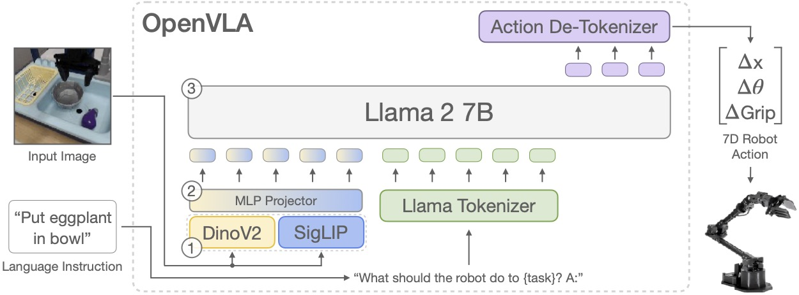

# OpenVLA / OpenVLA-OFT

[简体中文](openvla_ZH.md)

> **Category:** Vision-Language-Action Model · [Repository](https://github.com/openvla/openvla) · [Project Page](https://openvla.github.io/) · [Paper](https://arxiv.org/abs/2406.09246) · [OpenVLA-OFT](https://openvla-oft.github.io/)

  

<em>OpenVLA maps images and language instructions to tokenized robot actions. Image source: <a href="https://openvla.github.io/">official project page</a>.</em>

## Technical Summary

- **Role in the landscape:** influential open VLA baseline and Open X-Embodiment lineage.
- **Flagship size:** 7B parameters.
- **Inputs/outputs:** image and language to robot action; exact state, view, and action interfaces depend on checkpoint and recipe.
- **Action representation:** flagship OpenVLA discretizes actions as tokens; OFT documents a continuous-action fine-tuning recipe.

## Technical Contribution

OpenVLA made a generalist 7B VLA, checkpoints, inference, fine-tuning, evaluation, and serving material publicly accessible. It remains a useful reference point for studying how pretrained VLMs are adapted to robot control and how Open X-Embodiment data is mixed for generalist manipulation policies.

## Architecture and Data

The flagship model fine-tunes a Prismatic-7B VLM combining DINOv2 and SigLIP visual features with a Llama 2 language backbone. The official project reports pretraining on roughly 970k robot episodes from the Open X-Embodiment collection. Actions are decoded for the target dataset/robot using the appropriate normalization statistics.

The model path can be read as four stages:

1. DINOv2 and SigLIP encode the current robot-camera image into complementary visual features.
2. A projector maps those features into the language model's embedding space.
3. The Llama 2 backbone conditions on the image representation and natural-language instruction.
4. Predicted action tokens are detokenized and unnormalized for the target robot.

This design makes robot control look like next-token prediction, which simplifies reuse of a pretrained VLM but introduces action discretization and control-latency tradeoffs.

## Adaptation and Control

The original release supports full fine-tuning, LoRA, and quantized LoRA. A new robot or dataset requires the correct action statistics and dataset identifier because normalized outputs are embodiment-specific. The repository also includes a REST policy-serving path so that model inference can run separately from the robot client.

OpenVLA-OFT is a distinct optimized fine-tuning recipe rather than a rename of the original checkpoint. It replaces the original action-token decoding path with a continuous action head and introduces control-oriented improvements such as action chunking. Results should therefore identify both the base checkpoint and adaptation recipe.

## What Is Available

- MIT-licensed repository code.
- `openvla-7b` and an earlier `openvla-v01-7b` checkpoint.
- lightweight Hugging Face-style inference interface;
- LoRA, quantized LoRA, full fine-tuning, training, evaluation, and REST-serving paths;
- OpenVLA-OFT as a newer optimized recipe with continuous actions and faster control-oriented inference.

## Openness Caveats

- Repository code and model weights do not have identical licensing context: the flagship weights derive from Llama 2 and inherit relevant restrictions.
- Open X-Embodiment is a collection of datasets with dataset-specific availability and terms; a published mixture does not make every source uniformly redistributable.
- “OpenVLA result” is ambiguous unless the checkpoint and recipe—vanilla, FAST-related work, or OFT—are named.

## Research Use

OpenVLA is a strong reference when studying the original open VLA design, Open X-Embodiment pretraining, or parameter-efficient adaptation of a 7B policy. SmolVLA is usually easier for a first low-resource experiment, while openpi and GR00T expose different continuous-action and deployment choices.

## From Observation to Robot Action

An OpenVLA inference step begins with a camera image and an instruction such as a tabletop pick-and-place command. The vision encoders turn the image into features; the language backbone processes those features together with the instruction; the model then predicts tokens representing action values. Those tokens are decoded and unnormalized with statistics associated with the target dataset. The final values must be interpreted in that robot's action convention before a controller executes them. This last transformation is essential: a numerically valid action vector may be physically wrong if its coordinate frame, gripper sign, or normalization key differs from training.

The original token-based design is useful for studying how a pretrained language model can generate robot actions. It also makes action precision and decoding cost part of the control problem. OpenVLA-OFT changes the adaptation path by introducing continuous action prediction and action chunks, which can reduce repeated model calls during control. A paper comparing vanilla OpenVLA with an OFT result must therefore identify both the checkpoint and the decoding recipe.

## Using a Released Model

The official repository documents checkpoint loading, inference, LoRA or full fine-tuning, and evaluation. For a new task, prepare demonstrations with the camera and action schema expected by the chosen recipe, select the matching dataset normalization statistics, fine-tune, and evaluate on held-out initial states. The released 7B base checkpoint is a starting point, not a task-completion guarantee. OpenVLA is suited to studies of generalist VLA pretraining and language-conditioned manipulation; it does not by itself provide motion planning, collision checking, or a robot safety controller.

## References

- [Official repository](https://github.com/openvla/openvla)
- [Project page](https://openvla.github.io/)
- [Paper](https://arxiv.org/abs/2406.09246)
- [OpenVLA-OFT](https://openvla-oft.github.io/)

