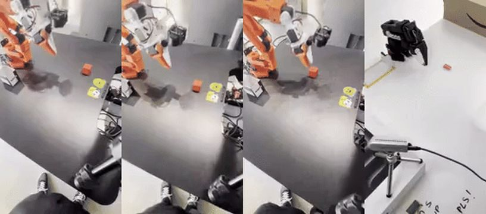

# SmolVLA

[English](smolvla.md)

> **类别：** 视觉—语言—动作模型 · [官方仓库](https://github.com/huggingface/lerobot) · [项目介绍](https://huggingface.co/blog/smolvla) · [模型卡](https://huggingface.co/lerobot/smolvla_base) · [论文](https://arxiv.org/abs/2506.01844)

  

<em>SmolVLA 在不同任务条件下运行。图片来源：<a href="https://huggingface.co/blog/smolvla">Hugging Face 官方文章</a>。</em>

## 概览

- **研究定位：** 集成于 LeRobot 工具链的紧凑型 VLA 模型。
- **模型规模：** 官方介绍约为 4.5 亿参数；模型卡采用约 5 亿参数的量级表述。
- **输入：** 多路相机图像、机器人状态与自然语言指令。
- **输出：** 连续动作片段。
- **动作生成：** 流匹配。

## 技术贡献

SmolVLA 在 LeRobot 中结合数据集、训练、评测和机器人控制工具。官方模型卡提供加载与推理示例，文档说明基础权重需要根据具体机器人和任务进行适配。

## 架构与数据

官方资料将 SmolVLA 描述为紧凑视觉语言主干与流匹配动作模块的组合，并通过减少视觉 token、跳过部分网络层和交错注意力等设计降低推理开销。模型使用具有兼容许可的 LeRobot 社区数据集预训练；官方文章报告训练数据少于 3 万段轨迹。

相机图像、机器人状态与语言指令共同形成动作生成条件，流匹配模块输出连续动作片段。较少的视觉 token 与选择性计算旨在降低推理成本，实际延迟仍取决于设备和输入配置。

## 数据与机器人接口

SmolVLA 使用 LeRobot 数据集和策略接口。目标数据集需要提供匹配的相机字段、机器人状态、动作、轨迹结构和归一化统计量。基础权重提供预训练表示；在目标机器人上实现有效控制通常仍需任务数据和微调。

LeRobot 将数据采集、离线训练、评测和机器人硬件接口集成在同一工具链中，减少了不同组件间的接口转换工作。

## 已开放内容

- 采用 Apache-2.0 许可证的 LeRobot 代码与基础模型卡。
- `lerobot/smolvla_base` 模型权重。
- 安装、模型加载、训练与真机评测文档。
- LeRobot 数据集及受支持机器人的接口。
- LIBERO、Meta-World、SO100 与 SO101 相关示例。

## 使用边界

- 基础模型需要适配目标任务；成功加载权重不等于能够直接控制机器人。
- 任务变化需要相应的示教数据覆盖；数据不足会影响控制表现。
- 消费级硬件上的推理延迟与显存占用取决于具体设备和输入配置，需要分别测量。

## 实验流程与条件

完整实验流程包括采集示教轨迹、构建 LeRobot 数据集、微调基础权重，并在固定机器人配置下评测。SmolVLA 的基础权重不应被视为适用于任意机器人的零样本控制策略；数据质量、相机配置、动作归一化与控制频率均影响结果。

## 一个动作片段如何生成

SmolVLA 接收一个或多个相机视角、机器人状态向量，以及可选的任务指令。紧凑型视觉语言主干提取场景和任务表征；独立的动作模块在这些特征条件下，通过流匹配生成连续动作片段。一次预测多个动作减少了频繁调用模型的成本，但机器人仍需决定执行多少步后重新观测。较长的开环片段降低推理频率，也增加了环境偏离预测时无法及时修正的时间。

## 从示教到可执行策略

LeRobot 数据集将图像、状态、动作和任务元数据组织为连续的 episode。训练配置需要与相机字段、状态和动作维度、动作预测范围及归一化统计量保持一致。微调基础权重后，应使用相同传感器和执行器定义，在新的场景初始状态上评测。模型能够加载并输出动作张量，只说明接口工作正常，并不能证明操作任务已经成功。

SmolVLA 适合学习示教采集、策略训练到机器人控制的完整流程。实际命令以官方 LeRobot 文档为准，数据格式与 CLI 应使用相互兼容的版本。

## 参考资料

- [LeRobot repository](https://github.com/huggingface/lerobot)
- [SmolVLA 官方文档](https://github.com/huggingface/lerobot/blob/main/docs/source/smolvla.mdx)
- [基础模型卡](https://huggingface.co/lerobot/smolvla_base)
- [官方文章](https://huggingface.co/blog/smolvla)
- [Paper](https://arxiv.org/abs/2506.01844)
