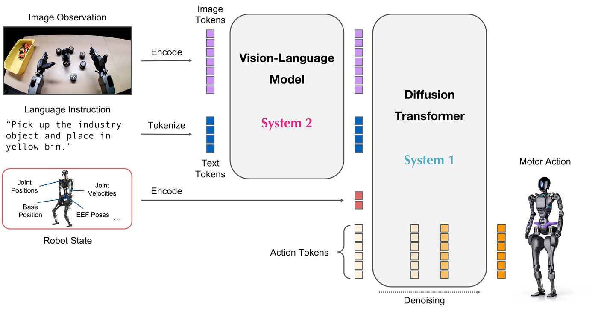

# NVIDIA Isaac GR00T N1.7

> **Category:** Vision-Language-Action Model · [Repository](https://github.com/NVIDIA/Isaac-GR00T) · [Publication](https://research.nvidia.com/publication/2025-03_nvidia-isaac-gr00t-n1-open-foundation-model-humanoid-robots) · [Paper](https://arxiv.org/abs/2503.14734)

  

<em>GR00T N1.7 model architecture. Image source: <a href="https://github.com/NVIDIA/Isaac-GR00T">official repository</a>.</em>

## Snapshot

- **Role in the landscape:** cross-embodiment VLA and deployment stack for manipulation and humanoid skills.
- **Released checkpoint:** `nvidia/GR00T-N1.7-3B`.
- **Backbone:** Cosmos-Reason2-2B / Qwen3-VL-based vision-language model.
- **Action generation:** diffusion-transformer head that denoises continuous actions.

## Why It Matters

GR00T N1.7 covers a broad engineering surface: LeRobot-format data, embodiment configurations, fine-tuning, PyTorch inference, server-client deployment, TensorRT paths, simulation benchmarks, and humanoid whole-body workflows.

## Architecture and Interface

The policy separates multimodal reasoning from high-frequency action generation. A vision-language backbone processes images and instructions, while a diffusion-transformer action head denoises continuous action chunks conditioned on those features and robot state. Embodiment-specific configurations define observation keys, state and action dimensions, horizons, and normalization behavior.

This separation lets the same repository support tabletop arms, bimanual systems, and humanoid workflows, but “cross-embodiment” does not mean one checkpoint can control every platform without matching data and configuration.

## Training and Deployment Workflow

The documented path starts with converting demonstrations to the supported LeRobot format, selecting an embodiment configuration, and fine-tuning a base checkpoint. Inference can run directly in Python or behind a ZMQ policy server. NVIDIA also documents TensorRT-oriented deployment paths and platform-specific setup for workstation, DGX, and Jetson-class devices.

## What Is Available

- Apache-2.0 repository code.
- weights under the NVIDIA Open Model License.
- base and selected fine-tuned checkpoints.
- single- and multi-GPU fine-tuning commands.
- benchmark guides for LIBERO, SimplerEnv Fractal/Bridge, and SO100.
- ZMQ policy server and documented TensorRT/platform paths.
- workflows for x86_64 dGPU, DGX Spark, Jetson AGX Thor, and Jetson Orin.

## Openness and Environment Caveats

- The model's VLM backbone is gated on Hugging Face and requires access/authentication.
- The repository uses submodules and Git LFS for some assets.
- GPU packages, FlashAttention, TorchCodec, FFmpeg versions, CUDA generations, and platform activation scripts create meaningful environment complexity.
- The official repository reports TensorRT rates on specific NVIDIA hardware; those numbers should not be generalized to other devices.
- Weight terms differ from the Apache-2.0 code license.

## Benchmark Surface

The repository provides benchmark-specific workflows rather than one universal command. Embodiment tags, environment prefixes, action spaces, checkpoint variants, and runtime backends must be recorded for a comparable result.

## When to Use It

GR00T N1.7 is most relevant when the research question includes deployment engineering, heterogeneous embodiments, or NVIDIA's simulation and acceleration stack. It has the widest documented systems surface in this comparison, but also the highest environment and hardware complexity.

## Primary Sources

- [Official repository](https://github.com/NVIDIA/Isaac-GR00T)
- [GR00T N1 publication](https://research.nvidia.com/publication/2025-03_nvidia-isaac-gr00t-n1-open-foundation-model-humanoid-robots)
- [GR00T N1 paper](https://arxiv.org/abs/2503.14734)

