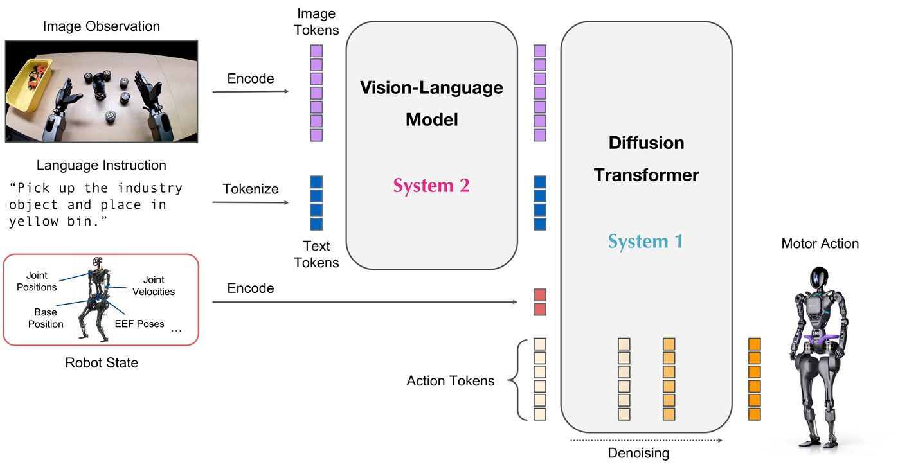

# NVIDIA Isaac GR00T N1.7

[English](gr00t-n1.7.md)

> **类别：** Vision-Language-Action Model · [Repository](https://github.com/NVIDIA/Isaac-GR00T) · [Publication](https://research.nvidia.com/publication/2025-03_nvidia-isaac-gr00t-n1-open-foundation-model-humanoid-robots) · [Paper](https://arxiv.org/abs/2503.14734)

  

<em>GR00T N1.7 model architecture。图片来源：<a href="https://github.com/NVIDIA/Isaac-GR00T">official repository</a>。</em>

## 概览

- **定位：** 面向 manipulation 与 humanoid skills 的 cross-embodiment VLA 和 deployment stack。
- **公开 checkpoint：** `nvidia/GR00T-N1.7-3B`。
- **Backbone：** Cosmos-Reason2-2B / Qwen3-VL-based vision-language model。
- **动作生成：** 使用 diffusion-transformer head 对 continuous actions 进行 denoising。

## 为什么重要

GR00T N1.7 覆盖较完整的工程链路，包括 LeRobot-format data、embodiment configuration、fine-tuning、PyTorch inference、server-client deployment、TensorRT、simulation benchmarks 和 humanoid whole-body workflow。

## 架构与接口

Policy 将 multimodal reasoning 与高频 action generation 分开处理。Vision-language backbone 读取图像和指令，diffusion-transformer action head 根据这些特征与 robot state 生成 continuous action chunks。Embodiment-specific configuration 定义 observation keys、state/action dimensions、horizon 与 normalization behavior。

这种设计让同一仓库能够支持 tabletop arms、bimanual systems 与 humanoid workflow，但 “cross-embodiment” 不代表一个 checkpoint 可以在没有匹配数据与配置的情况下控制所有平台。

## 训练与部署流程

官方流程从 demonstrations 转换为 LeRobot format 开始，随后选择 embodiment configuration 并 fine-tune base checkpoint。Inference 可以直接在 Python 中运行，也可以部署为 ZMQ policy server。NVIDIA 还提供 TensorRT 与 workstation、DGX、Jetson 等平台相关的配置路径。

## 已开放内容

- Apache-2.0 repository code。
- 使用 NVIDIA Open Model License 的 weights。
- Base 与部分 fine-tuned checkpoints。
- Single-GPU 与 multi-GPU fine-tuning commands。
- LIBERO、SimplerEnv Fractal/Bridge 和 SO100 benchmark guides。
- ZMQ policy server 与 TensorRT/platform deployment paths。

## 环境与开放性边界

- VLM backbone 在 Hugging Face 上需要 gated access 与 authentication。
- 仓库使用 submodules，部分素材依赖 Git LFS。
- GPU packages、FlashAttention、TorchCodec、FFmpeg、CUDA generation 和平台脚本带来较高环境复杂度。
- 官方 TensorRT 性能只适用于特定 NVIDIA hardware，不能直接推广到其他设备。
- Weight terms 与 Apache-2.0 code license 不相同。

## Benchmark 范围

仓库针对不同 benchmark 提供独立 workflow，而不是一条 universal command。为了得到可比结果，需要记录 embodiment tag、environment prefix、action space、checkpoint variant 与 runtime backend。

## 适用场景

GR00T N1.7 适合研究 deployment engineering、heterogeneous embodiments，以及 NVIDIA simulation 和 acceleration stack。它具有本组中最完整的 systems surface，同时环境和硬件门槛也最高。

## 原始来源

- [Official repository](https://github.com/NVIDIA/Isaac-GR00T)
- [GR00T N1 publication](https://research.nvidia.com/publication/2025-03_nvidia-isaac-gr00t-n1-open-foundation-model-humanoid-robots)
- [GR00T N1 paper](https://arxiv.org/abs/2503.14734)
