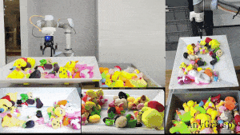

# AnyGrasp

[简体中文](anygrasp_ZH.md) · [Grasping models](README.md)

> Parallel-gripper grasp detection and tracking from point clouds · [Project](https://graspnet.net/anygrasp.html) · [SDK](https://github.com/graspnet/anygrasp_sdk) · [Paper](https://arxiv.org/abs/2212.08333)

  

*Official project demonstration.*

## Snapshot

- **Problem:** Detect stable 6-DoF grasp poses and track them over time in cluttered or dynamic scenes.
- **End effector:** Parallel gripper.
- **Observation:** Point clouds derived from depth sensing, optionally cropped or masked for a target region.
- **Output:** Grasp pose, width, score, and tracked candidates for downstream motion planning.

## Why It Matters

Many grasp detectors treat each frame independently. AnyGrasp joins spatial grasp perception with temporal correspondence, so a robot can preserve stable candidates while the camera, objects, or robot move. The system targets practical throughput and has demonstrations spanning clutter removal, deformable objects, transparent objects, and moving targets.

## Technical Shape

The spatial component builds on dense graspability reasoning from the GraspNet and Graspness / GSNet line. Candidate generation is paired with objectness filtering and model-free collision checking. The temporal component associates grasps across consecutive observations, reducing pose jitter and avoiding a complete restart at every frame.

The released SDK exposes options for dense prediction, object-mask filtering, and collision detection. Dense mode trades additional memory and latency for more candidates and is intended for special cases rather than the default path.

## Deployment Boundary

AnyGrasp is a perception component, not a complete pick-and-place policy. A working robot system still needs calibrated RGB-D sensing, point-cloud preprocessing, robot–camera transforms, candidate selection, inverse kinematics, motion planning, gripper control, and failure recovery.

The official SDK lists Python 3.6–3.10, PyTorch 1.7.1+, CUDA, MinkowskiEngine, and a compiled `pointnet2` module. Compatibility should be checked against the target GPU and operating system before treating the demo environment as deployable.

## Availability and License Boundary

The official repository provides SDK wrappers and examples, but the core AnyGrasp library is distributed through machine-bound license registration because of stated IP constraints. Users submit a machine feature ID and request a license. This is materially different from a conventional fully open-source implementation and should be considered before product integration or reproducibility claims.

## Primary Sources

- [Official project page](https://graspnet.net/anygrasp.html)
- [Official AnyGrasp SDK](https://github.com/graspnet/anygrasp_sdk)
- [AnyGrasp paper](https://arxiv.org/abs/2212.08333)
- [GraspNet project](https://graspnet.net/)
