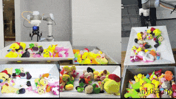

# AnyGrasp

[English](anygrasp.md) · [Grasping Models](README_ZH.md)

> 基于点云的平行夹爪抓取检测与时序跟踪 · [项目主页](https://graspnet.net/anygrasp.html) · [SDK](https://github.com/graspnet/anygrasp_sdk) · [论文](https://arxiv.org/abs/2212.08333)

  

*图片来源：官方项目演示。*

## 概览

- **研究问题：** 在杂乱或动态场景中检测六自由度抓取姿态，并在连续观测中跟踪候选抓取。
- **末端执行器：** 平行夹爪。
- **输入：** 深度传感器生成的点云，可按目标区域或掩码筛选。
- **输出：** 抓取姿态、夹爪开口宽度、评分及供运动规划使用的候选抓取。

## 技术贡献

逐帧独立检测可能导致候选抓取随观测变化而抖动。AnyGrasp 结合空间抓取检测与跨帧关联，在相机或物体运动时维持候选姿态的时序一致性。官方演示包括杂乱物体清理、柔性和透明物体以及运动目标等场景；这些演示不等同于统一协议下的成功率评测。

## 技术结构

空间模块沿用 GraspNet 与 Graspness / GSNet 系列的密集抓取可行性估计，并结合目标筛选与无需物体模型的碰撞检测。时序模块在连续观测之间关联抓取候选，以降低姿态抖动。

官方 SDK 提供密集预测、物体掩码筛选与碰撞检测等选项。密集预测会增加候选数量，同时提高显存与推理开销。

## 部署边界

AnyGrasp 输出抓取候选，并不直接完成抓取执行。端到端系统还需要 RGB-D 相机标定、点云预处理、相机与机器人坐标变换、候选选择、逆运动学、运动规划、夹爪控制与失败恢复。

当前 SDK 文档列出 Python 3.6–3.14、PyTorch 1.7.1+、CUDA 11.x/12.x/13.x 与 MinkowskiEngine 0.5.4。具体组合仍受 GPU、操作系统和编译扩展影响，安装时应以[官方安装说明](https://github.com/graspnet/anygrasp_sdk#installation)为准。

## 发布与 License 边界

官方仓库提供 SDK 接口与示例，但核心库的使用需要许可证注册。SDK 于 2026 年 7 月更换注册工具，旧版 `lib_cxx.so` 和 `license_checker` 流程不适用于更新后的版本。安装与再分发条件应以[当前注册说明](https://github.com/graspnet/anygrasp_sdk/tree/main/license_registration)为准。

## 参考资料

- [Official project page](https://graspnet.net/anygrasp.html)
- [Official AnyGrasp SDK](https://github.com/graspnet/anygrasp_sdk)
- [AnyGrasp paper](https://arxiv.org/abs/2212.08333)
- [GraspNet project](https://graspnet.net/)
