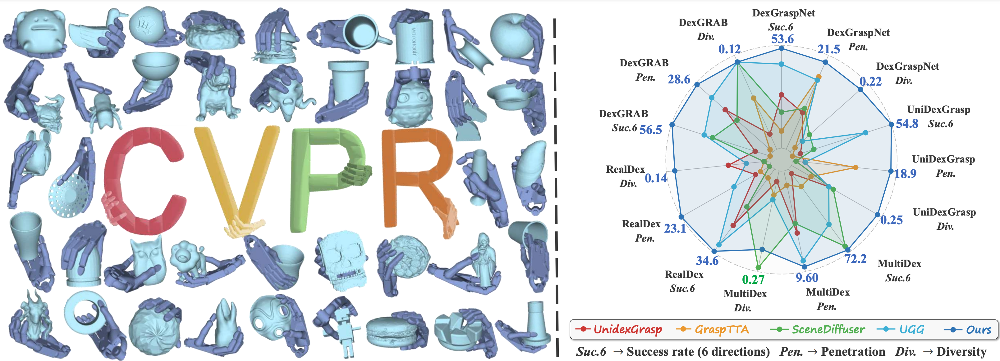

# DexGrasp Anything

[简体中文](dexgrasp-anything_ZH.md) · [Grasping models](README.md)

> Universal dexterous grasp generation with physics-aware diffusion · [Project](https://dexgraspanything.github.io/) · [Code](https://github.com/4DVLab/DexGrasp-Anything) · [Paper](https://arxiv.org/abs/2503.08257)

  

*Image source: official project repository.*

## Technical Summary

- **Problem:** Generate diverse, physically plausible high-DoF hand poses across many object categories.
- **Approach:** Conditional diffusion with physical constraints applied during training and sampling.
- **Primary hand:** Shadow Hand in the released experiments and dataset.
- **Venue:** CVPR 2025 Highlight.

## Physics-Aware Generation

DexGrasp Anything treats dexterous grasping as conditional generative modeling. Object geometry is encoded into semantic and spatial conditions, while the denoising process predicts hand configurations. Physical constraints guide the estimated clean pose during training and are applied again through a physics-guided sampler at inference time.

This design targets a recurring weakness of purely data-driven pose generation: a visually plausible hand configuration may penetrate the object, violate joint limits, or fail to establish stable contact. Physics guidance does not remove the need for simulator or real-world validation, but it moves these constraints into the generative process instead of relying only on post-filtering.

## Dataset and Cross-Dataset Evaluation

The project releases a dataset with more than 3.4 million grasp poses over more than 15,000 objects. It evaluates across DexGraspNet, UniDexGrasp, MultiDex, RealDex, and DexGRAB settings, using measures related to success, penetration, and diversity.

Those datasets differ in hand-pose conventions, object preprocessing, splits, and evaluation scripts. Reproduction should preserve coordinate transforms and clearly identify whether results use physics-guided sampling, LLM-derived conditions, or the base configuration.

## Reproduction Surface

The official repository provides source code, dataset links, checkpoints, training, sampling, and simulator-based testing. Its published setup uses Python 3.8, an older PyTorch/CUDA combination, PyTorch3D, CSDF, and Isaac Gym Preview 4. These dependencies are GPU- and version-sensitive.

The code repository declares an MIT license. Dataset and borrowed upstream assets should still be checked individually before redistribution.

## References

- [Official project page](https://dexgraspanything.github.io/)
- [Official repository](https://github.com/4DVLab/DexGrasp-Anything)
- [CVPR 2025 paper](https://arxiv.org/abs/2503.08257)
- [CVF open-access paper](https://openaccess.thecvf.com/content/CVPR2025/html/Zhong_DexGrasp_Anything_Towards_Universal_Robotic_Dexterous_Grasping_with_Physics_Awareness_CVPR_2025_paper.html)
