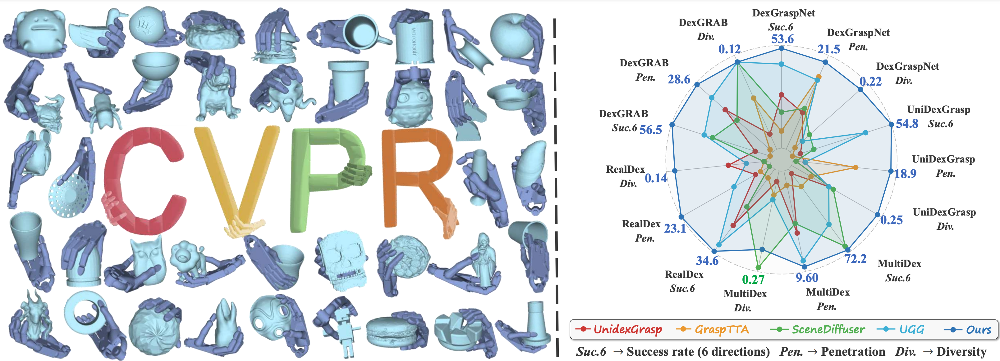

# DexGrasp Anything

[English](dexgrasp-anything.md) · [Grasping Models](README_ZH.md)

> 使用 physics-aware diffusion 实现 universal dexterous grasp generation · [Project](https://dexgraspanything.github.io/) · [Code](https://github.com/4DVLab/DexGrasp-Anything) · [Paper](https://arxiv.org/abs/2503.08257)

  

*图片来源：官方项目仓库。*

## 概览

- **问题：** 面向大量 object categories 生成多样且物理可行的 high-DoF hand poses。
- **Approach：** 在 training 与 sampling 阶段加入 physical constraints 的 conditional diffusion。
- **Primary hand：** 官方实验与 dataset 主要使用 Shadow Hand。
- **Venue：** CVPR 2025 Highlight。

## Physics-Aware Generation

DexGrasp Anything 将 dexterous grasping 表述为 conditional generative modeling。Object geometry 被编码为 semantic 与 spatial conditions，denoising process 则预测 hand configuration。Physical constraints 在训练时引导 estimated clean pose，并在 inference 阶段通过 physics-guided sampler 再次参与生成。

这一设计针对纯 data-driven pose generation 的常见问题：视觉上合理的 hand configuration 仍可能出现 object penetration、joint-limit violation 或无法形成 stable contact。Physics guidance 不能取代 simulator 或 real-world validation，但它将约束放进 generative process，而不是只依赖生成后的 filtering。

## Dataset 与 Cross-Dataset Evaluation

项目发布的数据包含超过 340 万个 grasp poses，覆盖超过 1.5 万个 objects。实验横跨 DexGraspNet、UniDexGrasp、MultiDex、RealDex 和 DexGRAB，并使用 success、penetration 与 diversity 相关指标。

这些 dataset 在 hand-pose convention、object preprocessing、split 和 evaluation script 上并不一致。复现时需要保留 coordinate transform，并明确结果使用 physics-guided sampling、LLM-derived condition，还是 base configuration。

## 复现条件

官方仓库提供 source code、dataset、checkpoint、training、sampling 和 simulator-based testing。发布环境使用 Python 3.8、较旧的 PyTorch/CUDA 组合、PyTorch3D、CSDF 和 Isaac Gym Preview 4，这些依赖对 GPU 和版本较为敏感。

代码仓库声明使用 MIT License，但 dataset 与借用的 upstream assets 在再分发前仍需分别核对许可。

## 原始来源

- [Official project page](https://dexgraspanything.github.io/)
- [Official repository](https://github.com/4DVLab/DexGrasp-Anything)
- [CVPR 2025 paper](https://arxiv.org/abs/2503.08257)
- [CVF open-access paper](https://openaccess.thecvf.com/content/CVPR2025/html/Zhong_DexGrasp_Anything_Towards_Universal_Robotic_Dexterous_Grasping_with_Physics_Awareness_CVPR_2025_paper.html)
