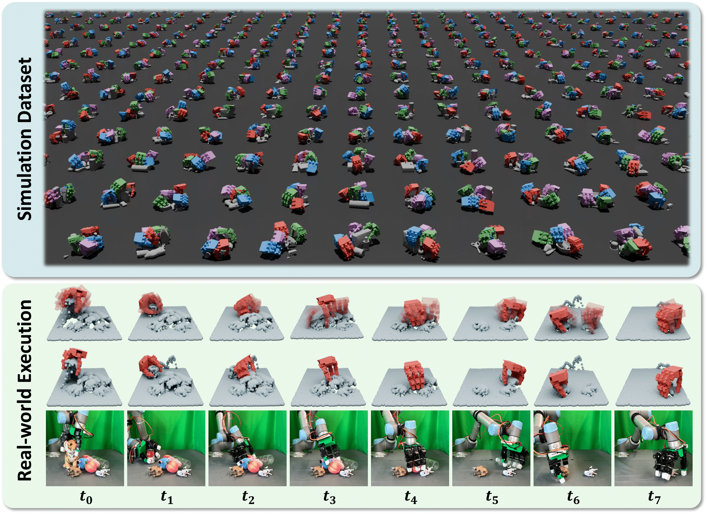

# DexGraspNet 2.0

[简体中文](dexgraspnet-2_ZH.md) · [Grasping models](README.md)

> Generative dexterous grasping in large-scale synthetic cluttered scenes · [Code](https://github.com/PKU-EPIC/DexGraspNet2) · [Paper](https://openreview.net/forum?id=885c47df6263f6be3a883d6b1bcd3e55048d7f2d)

  

*Image source: official project repository.*

## Snapshot

- **Problem:** Generate dexterous-hand grasps directly in cluttered scenes rather than treating every object in isolation.
- **Input:** Scene point clouds with object and neighborhood geometry.
- **Output:** Collision-aware grasp poses for a dexterous hand.
- **Venue:** CoRL 2024.

## From Object-Level Data to Cluttered Scenes

The original DexGraspNet scales stable grasp synthesis for isolated objects. DexGraspNet 2.0 extends the setting to synthetic cluttered scenes, where a useful grasp must account for the target geometry and nearby obstacles. This shifts the problem from object-only pose generation toward scene-conditioned grasping.

The method uses a generative model conditioned on local scene features. The accompanying pipeline includes synthetic scene construction, signed-distance tooling, grasp generation, and evaluation. This makes the work relevant both as a model and as infrastructure for producing scene-level dexterous-grasp data.

## Evaluation Boundary

Results depend on scene generation, target selection, collision geometry, hand model, simulator validation, and the definition of grasp success. Object-level benchmarks and cluttered-scene results answer different questions and should not be merged into one ranking.

The paper reports real-world experiments, but transferring a generated pose still requires perception calibration, hand–object registration, approach planning, controller design, and hardware-specific contact handling.

## Reproduction Notes

The official setup targets Ubuntu 20.04, Python 3.8, CUDA 11.7, PyTorch 2.0.1, PyTorch3D, TorchSDF, and additional SDF tooling. These tightly coupled compiled dependencies make environment reproduction a first-class part of the experiment.

## Primary Sources

- [Official repository](https://github.com/PKU-EPIC/DexGraspNet2)
- [CoRL 2024 paper](https://openreview.net/forum?id=885c47df6263f6be3a883d6b1bcd3e55048d7f2d)
- [DexGraspNet project](https://pku-epic.github.io/DexGraspNet/)
