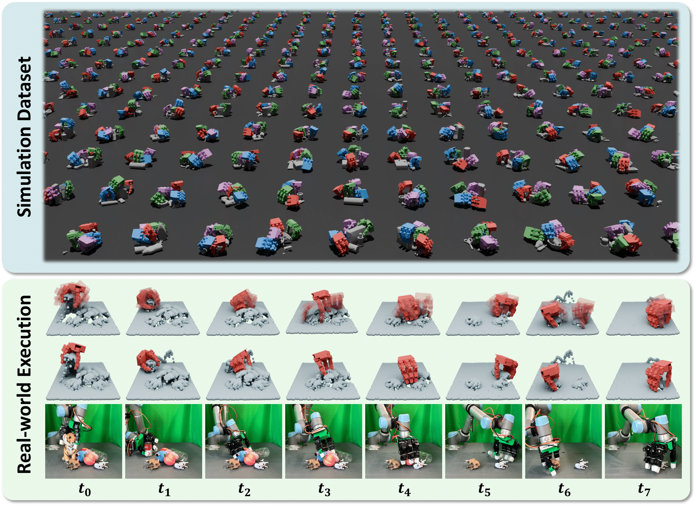

# DexGraspNet 2.0

[English](dexgraspnet-2.md) · [Grasping Models](README_ZH.md)

> 面向大规模 synthetic cluttered scenes 的 generative dexterous grasping · [Code](https://github.com/PKU-EPIC/DexGraspNet2) · [Paper](https://openreview.net/forum?id=885c47df6263f6be3a883d6b1bcd3e55048d7f2d)

  

*图片来源：官方项目仓库。*

## 概览

- **问题：** 直接在 cluttered scene 中生成 dexterous-hand grasp，而不是孤立处理每个 object。
- **Input：** 包含目标与周边几何信息的 scene point cloud。
- **Output：** 面向 dexterous hand 的 collision-aware grasp poses。
- **Venue：** CoRL 2024。

## 从 Object-Level Data 到 Cluttered Scenes

原始 DexGraspNet 扩展了 isolated object 的 stable grasp synthesis。DexGraspNet 2.0 将设定推进到 synthetic cluttered scenes，使有效抓取必须同时考虑目标几何与附近障碍物。这让问题从 object-only pose generation 转向 scene-conditioned grasping。

该方法使用以 local scene features 为条件的 generative model。配套 pipeline 覆盖 synthetic scene construction、signed-distance tooling、grasp generation 与 evaluation，因此它既是一个模型工作，也提供了生成 scene-level dexterous-grasp data 的基础设施。

## 评估边界

结果会受到 scene generation、target selection、collision geometry、hand model、simulator validation 和 grasp success definition 影响。Object-level benchmark 与 cluttered-scene result 回答的是不同问题，不应该合并为同一排名。

论文包含 real-world experiment，但把 generated pose 转移到真实系统仍需要 perception calibration、hand–object registration、approach planning、controller design 和 hardware-specific contact handling。

## 复现说明

官方环境面向 Ubuntu 20.04、Python 3.8、CUDA 11.7、PyTorch 2.0.1、PyTorch3D、TorchSDF 和额外 SDF tooling。由于多个 compiled dependencies 紧密耦合，environment reproduction 本身就是实验的重要组成部分。

## 原始来源

- [Official repository](https://github.com/PKU-EPIC/DexGraspNet2)
- [CoRL 2024 paper](https://openreview.net/forum?id=885c47df6263f6be3a883d6b1bcd3e55048d7f2d)
- [DexGraspNet project](https://pku-epic.github.io/DexGraspNet/)
