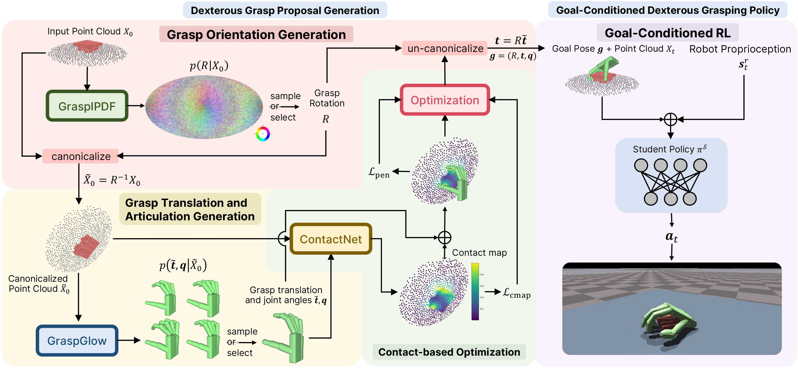

# UniDexGrasp

[English](unidexgrasp.md) · [Grasping Models](README_ZH.md)

> 通过 diverse proposal generation 与 goal-conditioned execution 实现 universal dexterous grasping · [Project](https://pku-epic.github.io/UniDexGrasp/) · [Code](https://github.com/PKU-EPIC/UniDexGrasp) · [Paper](https://arxiv.org/abs/2303.00938)

  

*图片来源：官方项目仓库。*

## 概览

- **问题：** 使用 high-DoF dexterous hand 抓取并抬升 tabletop 场景中的 seen 与 unseen objects。
- **Input：** 真实感 object point-cloud observation，以及执行阶段的 robot state。
- **Output：** Diverse target grasp poses，以及执行所选目标的 policy。
- **Venue：** CVPR 2023。

## Two-Stage Design

UniDexGrasp 将问题拆分为 grasp proposal generation 与 grasp execution。Proposal model 以 object point cloud 为条件，将 rotation 与 translation、hand articulation 分解建模，从而采样多样的目标姿态。由于 dexterous contact 与 articulation 让直接规划更加困难，execution stage 使用 goal-conditioned policy 替代传统 motion planning。

Policy learning pipeline 使用 state canonicalization、object curriculum 和 teacher–student distillation，在训练时利用 privileged simulation information，同时在部署时接收更真实的观测。这里必须区分两个问题：静态姿态具有物理可行性，并不意味着机械手一定能完成 approach、contact、lift 和 error recovery。

## 数据与评估

该工作建立在大规模 synthetic dexterous-grasp collection 上，并评估大量 object instances 及 unseen objects 的 generalization。最终 success 会受到 proposal generator、target selection、simulator setup、policy observation 和 execution criterion 的共同影响，因此 pose-generation score 与 end-to-end lift success 应分别报告。

## 复现边界

官方仓库分别提供 `dexgrasp_generation` 和 `dexgrasp_policy`，对应其 two-stage design。它是一套 research stack，而不是封装完整的 robot SDK；simulation、CUDA、point-cloud 与 reinforcement-learning dependencies 需要严格对齐版本。

官方仓库说明该工作与 dataset 使用 CC BY-NC 4.0，进行下游部署或再分发前需要特别检查 non-commercial restriction。

## 原始来源

- [Official project page](https://pku-epic.github.io/UniDexGrasp/)
- [Official repository](https://github.com/PKU-EPIC/UniDexGrasp)
- [CVPR 2023 paper](https://arxiv.org/abs/2303.00938)
- [DexGraspNet foundation](https://pku-epic.github.io/DexGraspNet/)
