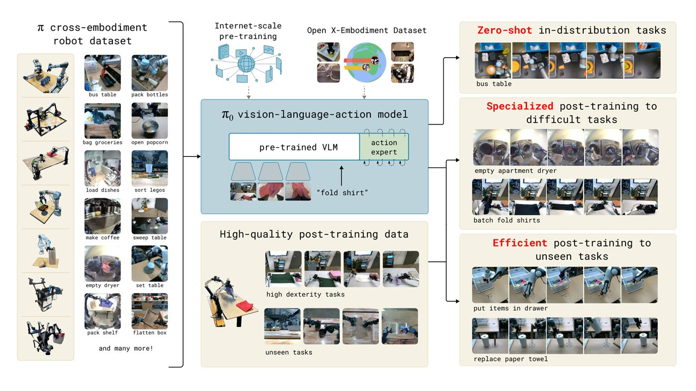

# π0 / π0-FAST / π0.5 via openpi

  

<em>π0 model, data, and adaptation overview. Image source: <a href="https://arxiv.org/abs/2410.24164">official paper</a>.</em>

## Snapshot

- **Role in the landscape:** an official implementation and release surface for Physical Intelligence robot-policy models.
- **Variants:** π0, π0-FAST, and π0.5.
- **Action generation:** flow matching for π0 and the currently supported π0.5 head; autoregressive action tokens for π0-FAST.

## Why It Matters

openpi makes architectural alternatives visible within one model family and publishes both base checkpoints and several task/robot-specific expert checkpoints. It also exposes data conversion, normalization, training, policy serving, and robot/simulation examples, which makes system boundaries easier to inspect.

## Model Family

- **π0** combines a pretrained vision-language model with a flow-matching action expert for continuous control.
- **π0-FAST** represents actions with FAST tokens and predicts them autoregressively, making action generation closer to language-token modeling.
- **π0.5** extends the generalist-policy line with a stronger open-world formulation; the released openpi implementation uses a continuous action expert for supported checkpoints.

These names describe different model and action-generation choices. A result should name the exact checkpoint rather than use “openpi” as if it were a single policy.

## Data and Adaptation Path

The official materials describe pretraining on a mixture of Internet-scale vision-language knowledge, open robot datasets, and Physical Intelligence's multi-robot data. The public repository supports converting target data into a LeRobot-style representation, computing normalization statistics, defining a robot-specific configuration, and fine-tuning with LoRA or full parameters depending on the recipe.

For deployment, a policy process can serve actions over WebSocket while a separate robot or simulator client supplies observations. This boundary is useful when the robot machine cannot host the full accelerator environment.

## What Is Available

- Apache-2.0 repository code, with additional upstream license notices including Gemma-related terms.
- π0, π0-FAST, and π0.5 base checkpoints described as pretrained on more than 10k hours of robot data.
- expert checkpoints for DROID, ALOHA, and LIBERO use cases.
- JAX-centered training plus published PyTorch support.
- LeRobot-format data conversion, fine-tuning, local inference, and WebSocket remote serving.
- Docker and `uv` installation paths.

## Published Requirements

The official repository estimates, for a single GPU:

- inference: more than 8 GB GPU memory;
- LoRA fine-tuning: more than 22.5 GB;
- full fine-tuning: more than 70 GB;
- tested OS: Ubuntu 22.04, with other operating systems currently unsupported.

These are project estimates and have not been reproduced by OpenEmbodied.

## Caveats

- The official repository explicitly warns that a checkpoint developed for its robots may not adapt successfully to another platform.
- Expert checkpoints may generalize differently from base checkpoints; robot interface and normalization must match.
- Repository license and model dependency terms should be reviewed separately.
- Reported LIBERO performance should be compared only after aligning the exact checkpoint and protocol.

## When to Use It

openpi is particularly useful for studying flow matching versus autoregressive action tokens, cross-embodiment adaptation, and remote policy serving. It offers more model-family breadth than a single-checkpoint repository, but new robot integrations require careful observation/action transforms and are not guaranteed to inherit the published capabilities.

## Primary Sources

- [Official repository](https://github.com/Physical-Intelligence/openpi)
- [π0 project page](https://www.physicalintelligence.company/blog/pi0)
- [π0.5 project page](https://www.physicalintelligence.company/blog/pi05)
- [π0 paper](https://arxiv.org/abs/2410.24164)

