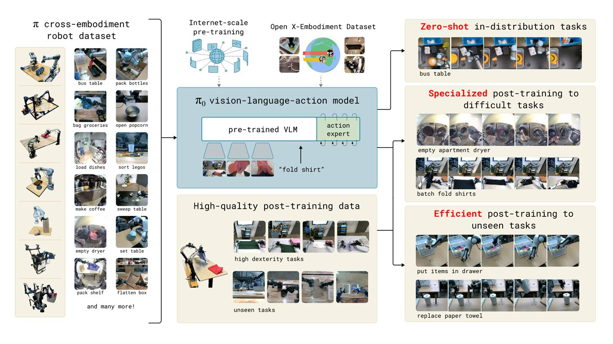

# π0 / π0-FAST / π0.5 via openpi

[English](openpi.md)

> **类别：** Vision-Language-Action Model · [Repository](https://github.com/Physical-Intelligence/openpi) · [π0](https://www.pi.website/blog/pi0) · [π0.5](https://www.pi.website/blog/pi05) · [Paper](https://arxiv.org/abs/2410.24164)

  

<em>π0 的模型、数据与适配流程。图片来源：<a href="https://arxiv.org/abs/2410.24164">official paper</a>。</em>

## 概览

- **定位：** Physical Intelligence robot-policy family 的官方实现与开放入口。
- **主要变体：** π0、π0-FAST 与 π0.5。
- **动作生成：** π0 与当前支持的 π0.5 head 使用 flow matching；π0-FAST 使用 autoregressive action tokens。

## 为什么重要

openpi 在同一 model family 中展示了不同 action representation，并公开 base checkpoints 与多个面向 robot/task 的 expert checkpoints。仓库也覆盖 data conversion、normalization、training、policy serving 以及 robot/simulation examples，便于理解完整系统的边界。

## Model Family

- **π0** 将 pretrained VLM 与 flow-matching action expert 结合，生成 continuous control。
- **π0-FAST** 使用 FAST tokens 表示动作，并以 autoregressive 方式预测，使 action generation 更接近 language-token modeling。
- **π0.5** 扩展了 generalist-policy 与 open-world 能力；openpi 当前公开实现为支持的 checkpoint 提供 continuous action expert。

这些名称对应不同的模型与动作生成方案。报告结果时应说明具体 checkpoint，而不是把 “openpi” 当作单一 policy。

## 数据与适配流程

官方资料描述的 pretraining mixture 包括 Internet-scale vision-language knowledge、开放 robot datasets 以及 Physical Intelligence 的 multi-robot data。公开仓库支持将目标数据转换为 LeRobot 风格格式、计算 normalization statistics、定义 robot-specific configuration，并根据 recipe 使用 LoRA 或 full fine-tuning。

部署时，policy process 可以通过 WebSocket 提供动作服务，robot 或 simulator client 单独提交 observations。这种结构适合 robot 端无法直接运行完整 accelerator environment 的情况。

## 已开放内容

- Apache-2.0 repository code，以及 Gemma 等 upstream license notices。
- π0、π0-FAST 与 π0.5 base checkpoints。
- 面向 DROID、ALOHA 与 LIBERO 的 expert checkpoints。
- 以 JAX 为主的训练代码及公开 PyTorch support。
- LeRobot-format conversion、fine-tuning、local inference 与 WebSocket serving。
- Docker 与 `uv` installation path。

## 官方硬件需求

仓库给出的单 GPU 估算为：inference 需要超过 8 GB GPU memory，LoRA fine-tuning 超过 22.5 GB，full fine-tuning 超过 70 GB。官方测试系统为 Ubuntu 22.04。这些是项目侧估算，不代表所有配置下的独立测量结果。

## 使用边界

- 官方明确提示：为其 robot 开发的 checkpoint 不保证能成功适配其他平台。
- Expert checkpoint 与 base checkpoint 的泛化表现不同，robot interface 与 normalization 必须匹配。
- Repository license 与 model dependency terms 需要分别检查。
- LIBERO 结果只有在 checkpoint 与 protocol 对齐后才适合比较。

## 适用场景

openpi 特别适合研究 flow matching 与 autoregressive action tokens 的差异、cross-embodiment adaptation，以及 remote policy serving。它比单 checkpoint 仓库提供更丰富的 model-family 选择，但新 robot integration 需要严格处理 observation/action transforms。

## 原始来源

- [Official repository](https://github.com/Physical-Intelligence/openpi)
- [π0 project page](https://www.pi.website/blog/pi0)
- [π0.5 project page](https://www.pi.website/blog/pi05)
- [π0 paper](https://arxiv.org/abs/2410.24164)
