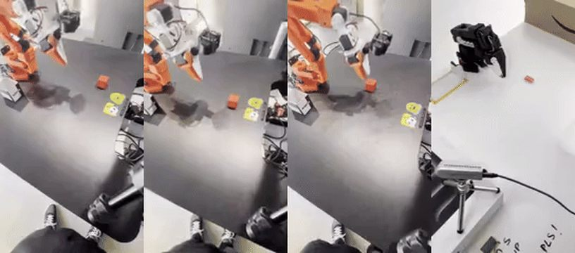

# SmolVLA

[简体中文](smolvla_ZH.md)

> **Category:** Vision-Language-Action Model · [Repository](https://github.com/huggingface/lerobot) · [Project Article](https://huggingface.co/blog/smolvla) · [Model](https://huggingface.co/lerobot/smolvla_base) · [Paper](https://arxiv.org/abs/2506.01844)

  

<em>SmolVLA operating across task variations. Image source: <a href="https://huggingface.co/blog/smolvla">official Hugging Face article</a>.</em>

## Snapshot

- **Role in the landscape:** compact VLA designed for affordable experimentation and LeRobot workflows.
- **Size:** 450M in official materials; the Hub model card displays approximately 0.5B parameters.
- **Inputs:** multiple camera images, robot state, and optional language instruction.
- **Output:** continuous action chunks.
- **Training objective:** flow matching.

## Why It Matters

SmolVLA connects a relatively small policy to a maintained data, training, evaluation, and robot-control ecosystem. Its official model card provides a direct load-and-infer example, and the project is explicitly designed for task-specific fine-tuning and lower-cost hardware.

## Architecture and Data

Official materials describe a compact VLM-based architecture with a flow-matching action expert, reduced visual tokens, and attention choices designed for efficient inference. The model was pretrained on compatible, community-shared LeRobot datasets; the official article describes fewer than 30k training episodes.

The policy combines a compact vision-language backbone with a separate action expert. Camera images, robot state, and an optional task instruction provide context; flow matching then generates a chunk of continuous actions. Visual token reduction, selective layer use, and interleaved attention are intended to keep the model small enough for accessible experimentation.

## Data and Robot Interface

SmolVLA uses the LeRobot dataset and policy interfaces. A target dataset must define compatible camera keys, robot state, actions, episode structure, and normalization statistics. The base checkpoint supplies general pretrained features, but robot-specific fine-tuning is still the normal path to a working controller.

LeRobot connects the model to dataset recording, offline training, evaluation, and supported low-cost robot hardware. This integrated workflow is a practical advantage: model code and robot tooling live in the same ecosystem instead of requiring a custom serving bridge.

## What Is Available

- Apache-2.0 LeRobot code and Apache-2.0 base model card.
- `lerobot/smolvla_base` checkpoint.
- documented installation, model loading, training, and real-robot evaluation paths.
- integration with LeRobot datasets and supported robot interfaces.
- official examples involving LIBERO, Meta-World, SO100, and SO101 contexts.

## Evidence and Caveats

- The base model is intended to be fine-tuned for a target use case; loading the checkpoint is not equivalent to having a successful robot policy.
- Official guidance suggests collecting repeated demonstrations across task variations and notes that insufficient data can produce poor results.
- “Runs on consumer hardware” is a project claim that still needs device-specific latency and memory measurement.

## Practical Starting Point

SmolVLA is the most approachable profile in this set for learning the complete VLA loop: record demonstrations, publish or load a LeRobot dataset, fine-tune the base model, and evaluate on the same robot configuration. It is not a zero-shot universal policy; dataset quality, camera consistency, action normalization, and control frequency remain decisive.

## Primary Sources

- [LeRobot repository](https://github.com/huggingface/lerobot)
- [Official SmolVLA documentation](https://github.com/huggingface/lerobot/blob/main/docs/source/smolvla.mdx)
- [Base model card](https://huggingface.co/lerobot/smolvla_base)
- [Official article](https://huggingface.co/blog/smolvla)
- [Paper](https://arxiv.org/abs/2506.01844)

