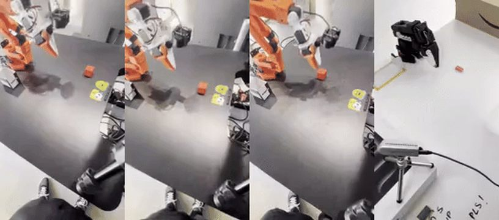

# SmolVLA

[English](smolvla.md)

> **类别：** Vision-Language-Action Model · [Repository](https://github.com/huggingface/lerobot) · [Project Article](https://huggingface.co/blog/smolvla) · [Model](https://huggingface.co/lerobot/smolvla_base) · [Paper](https://arxiv.org/abs/2506.01844)

  

<em>SmolVLA 在不同任务条件下运行。图片来源：<a href="https://huggingface.co/blog/smolvla">official Hugging Face article</a>。</em>

## 概览

- **定位：** 面向低成本实验并集成于 LeRobot 工作流的 compact VLA。
- **规模：** 官方资料为 450M，Hub model card 显示约 0.5B parameters。
- **输入：** 多路 camera images、robot state 与可选 language instruction。
- **输出：** Continuous action chunks。
- **训练目标：** Flow matching。

## 为什么重要

SmolVLA 将较小的 policy 与持续维护的数据、训练、评测和 robot-control 生态连接起来。官方 model card 提供直接的加载与 inference 示例，项目明确面向 task-specific fine-tuning 和更易获得的硬件环境。

## 架构与数据

官方资料将 SmolVLA 描述为由 compact VLM 与 flow-matching action expert 组成的架构，并通过 visual token reduction、layer skipping 和 interleaved attention 等设计降低 inference 成本。模型使用兼容 license 的社区 LeRobot datasets 预训练，官方文章称训练数据少于 3 万 episodes。

Camera images、robot state 与可选 instruction 共同提供条件，flow matching 生成 continuous action chunk。较少的 visual tokens 与选择性的网络计算，使其更适合入门和低成本研究。

## 数据与 Robot Interface

SmolVLA 使用 LeRobot dataset 和 policy interface。目标 dataset 需要定义兼容的 camera keys、robot state、actions、episode structure 与 normalization statistics。Base checkpoint 提供通用 pretrained representation，但获得可工作的 controller 通常仍需要针对目标 robot 进行 fine-tuning。

LeRobot 将 dataset recording、offline training、evaluation 与低成本 robot hardware 放在同一生态中，这减少了自行设计 policy serving bridge 的工程负担。

## 已开放内容

- Apache-2.0 LeRobot code 与 base model card。
- `lerobot/smolvla_base` checkpoint。
- Installation、model loading、training 与 real-robot evaluation 文档。
- LeRobot datasets 与受支持 robot interface 的集成。
- LIBERO、Meta-World、SO100 与 SO101 相关示例。

## 使用边界

- Base model 需要适配目标任务；成功加载 checkpoint 不等于能够直接控制 robot。
- 官方建议为任务变化采集多次 demonstrations，数据不足会明显影响结果。
- “Runs on consumer hardware” 仍需要结合具体 device 测量 latency 与 memory。

## 实践起点

SmolVLA 适合用来学习完整 VLA 流程：采集 demonstrations、构建 LeRobot dataset、fine-tune base model，并在一致的 robot configuration 上评测。它不是 zero-shot universal policy，dataset quality、camera consistency、action normalization 与 control frequency 仍是决定性因素。

## 原始来源

- [LeRobot repository](https://github.com/huggingface/lerobot)
- [Official SmolVLA documentation](https://github.com/huggingface/lerobot/blob/main/docs/source/smolvla.mdx)
- [Base model card](https://huggingface.co/lerobot/smolvla_base)
- [Official article](https://huggingface.co/blog/smolvla)
- [Paper](https://arxiv.org/abs/2506.01844)
