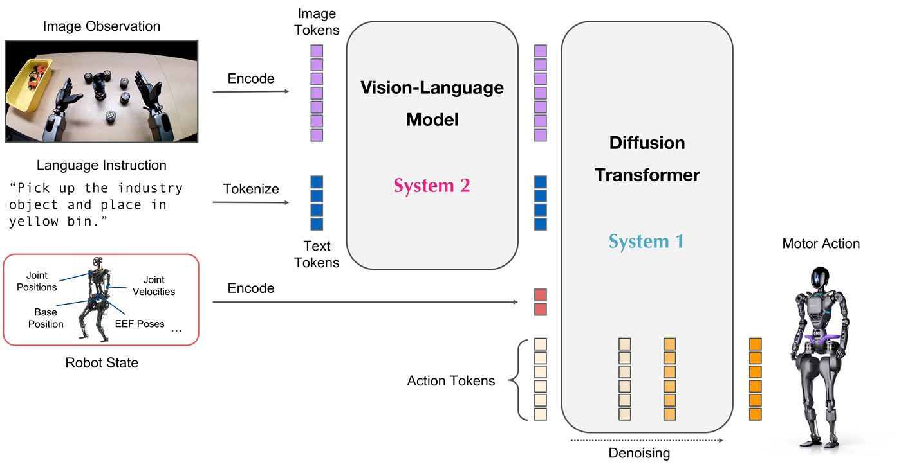

# NVIDIA Isaac GR00T N1.7

[English](gr00t-n1.7.md)

> **类别：** 视觉—语言—动作模型 · [官方仓库](https://github.com/NVIDIA/Isaac-GR00T) · [GR00T N1 研究论文](https://arxiv.org/abs/2503.14734)

  

<em>GR00T N1.7 模型架构。图片来源：<a href="https://github.com/NVIDIA/Isaac-GR00T">官方仓库</a>。</em>

## 概览

- **研究定位：** 面向跨机器人形态操作任务的 VLA 模型与部署工具链。
- **公开权重：** `nvidia/GR00T-N1.7-3B`。
- **视觉语言主干：** 官方仓库列出的 Cosmos-Reason2-2B / Qwen3-VL 方案。
- **动作生成：** 流匹配动作 Transformer 生成连续动作片段。

## 技术贡献

GR00T N1.7 官方仓库提供数据格式转换、机器人形态配置、微调、PyTorch 推理、策略服务、TensorRT 加速和仿真评测等流程。不同机器人平台需要分别配置观测和动作接口。

## 架构与接口

模型将视觉语言处理与动作生成分开：视觉语言主干读取图像和指令，流匹配动作 Transformer 结合机器人状态生成连续动作片段。机器人形态配置定义观测字段、状态与动作维度、预测时域及归一化方式。

同一工具链可用于机械臂、双臂与人形机器人任务，但跨形态支持不意味着单一权重无需适配即可控制任意平台。

## 训练与部署流程

官方流程先将示教数据转换为 LeRobot 格式，再选择机器人形态配置并微调基础权重。推理可以在 Python 进程中直接运行，也可通过 ZMQ 策略服务与控制客户端通信。仓库还提供 TensorRT 及工作站、DGX、Jetson 平台的部署说明。

## 已开放内容

- Apache-2.0 repository code。
- 使用 NVIDIA Open Model License 的 weights。
- Base 与部分 fine-tuned checkpoints。
- Single-GPU 与 multi-GPU fine-tuning commands。
- LIBERO、SimplerEnv Fractal/Bridge 和 SO100 的评测指南。
- 基于 ZMQ 的策略服务，以及 TensorRT 和特定平台的部署流程。

## 环境与开放性边界

- VLM backbone 在 Hugging Face 上需要 gated access 与 authentication。
- 仓库使用 submodules，部分素材依赖 Git LFS。
- GPU packages、FlashAttention、TorchCodec、FFmpeg、CUDA generation 和平台脚本带来较高环境复杂度。
- 官方 TensorRT 性能只适用于特定 NVIDIA hardware，不能直接推广到其他设备。
- Weight terms 与 Apache-2.0 code license 不相同。

## 评测范围

官方仓库为不同评测基准提供独立流程。比较结果时，应记录机器人形态标识、环境配置前缀、动作空间、权重版本和运行后端。

## 研究用途

GR00T N1.7 涉及跨形态模型适配、策略服务及 NVIDIA 推理加速。具体硬件需求、依赖组合和可用权重应以对应版本的官方仓库说明为准。

## 参考资料

- [Official repository](https://github.com/NVIDIA/Isaac-GR00T)
- [GR00T N1.7 模型卡](https://huggingface.co/nvidia/GR00T-N1.7-3B)
- [GR00T N1 publication](https://research.nvidia.com/publication/2025-03_nvidia-isaac-gr00t-n1-open-foundation-model-humanoid-robots)
- [GR00T N1 paper](https://arxiv.org/abs/2503.14734)
