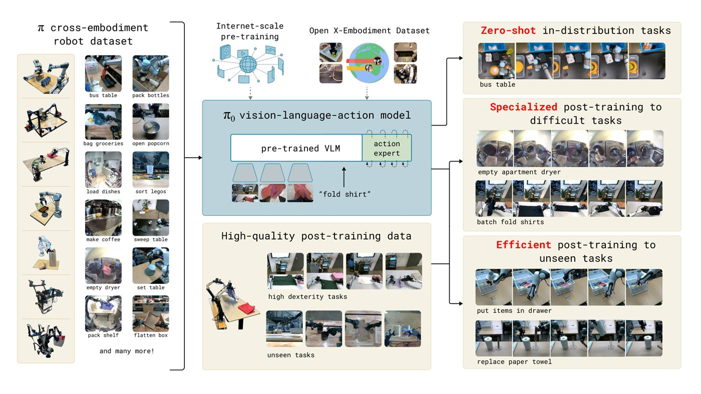

# openpi：π0 / π0-FAST / π0.5

[English](openpi.md)

> **类别：** 视觉—语言—动作模型 · [官方仓库](https://github.com/Physical-Intelligence/openpi) · [π0 项目介绍](https://www.pi.website/blog/pi0) · [π0.5 项目介绍](https://www.pi.website/blog/pi05) · [论文](https://arxiv.org/abs/2410.24164)

<p align="center">
  
</p>

<p align="center"><em>π0 的模型、数据与适配流程。图片来源：<a href="https://arxiv.org/abs/2410.24164">原论文</a>。</em></p>

## 概览

- **定位：** Physical Intelligence 机器人策略模型系列的公开实现。
- **主要变体：** π0、π0-FAST 与 π0.5。
- **动作生成：** π0 与当前公开的 π0.5 动作头使用流匹配；π0-FAST 使用自回归动作 token。

## 技术贡献

openpi 是官方代码仓库；π0、π0-FAST 和 π0.5 则是具有各自权重的不同模型变体。openpi 在同一模型系列中提供不同的动作表示，并发布基础权重及多个面向特定机器人或任务的权重。仓库还包含数据转换、归一化、训练、策略服务及机器人和仿真示例，覆盖从数据到部署的主要接口。

## 模型系列

- **π0** 结合预训练视觉语言模型与流匹配动作模块，生成连续动作。
- **π0-FAST** 使用 FAST 动作 token，并通过自回归预测生成动作序列。
- **π0.5** 扩展开放场景中的策略能力；openpi 当前实现支持其流匹配动作头。

这些名称对应不同的模型与动作生成方案。报告结果时需要明确具体权重，而不能将“openpi”视为单一策略。

## 数据与适配流程

官方资料描述的预训练数据来源包括大规模视觉语言数据、开放机器人数据集，以及 Physical Intelligence 的多机器人数据。公开仓库支持目标数据转换、归一化统计计算、机器人专用配置，以及 LoRA 或全参数微调。

部署时，策略进程可以通过 WebSocket 提供动作服务，机器人或仿真客户端独立提交观测数据。推理设备与机器人控制端因此可以分开运行，但仍需匹配观测和动作接口。

## 已开放内容

- Apache-2.0 repository code，以及 Gemma 等 upstream license notices。
- π0、π0-FAST 与 π0.5 base checkpoints。
- 面向 DROID、ALOHA 与 LIBERO 的 expert checkpoints。
- 以 JAX 为主的训练代码及公开 PyTorch support。
- LeRobot 格式转换、微调、本地推理与 WebSocket 服务。
- Docker 与 `uv` installation path。

## 官方硬件需求

仓库给出的单 GPU 估算为：inference 需要超过 8 GB GPU memory，LoRA fine-tuning 超过 22.5 GB，full fine-tuning 超过 70 GB。官方测试系统为 Ubuntu 22.04。这些是项目侧估算，不代表所有配置下的独立测量结果。

## 训练流程

以下命令对应官方基于 JAX 的 π0.5 + LIBERO 示例，应在 **openpi 上游仓库的克隆目录** 中、使用受支持的 Ubuntu GPU 环境执行。示例配置 `pi05_libero` 已指向转换后的 LIBERO 数据；接入自有机器人数据时，需要分别配置数据处理与训练参数。

1. 连同子模块克隆仓库，并安装锁定的依赖环境：

   ```bash
   git clone --recurse-submodules https://github.com/Physical-Intelligence/openpi.git
   cd openpi
   GIT_LFS_SKIP_SMUDGE=1 uv sync
   GIT_LFS_SKIP_SMUDGE=1 uv pip install -e .
   ```

2. 自有数据需先转换为 LeRobot 格式。上游的 `examples/libero/convert_libero_data_to_lerobot.py` 提供了具体示例。随后在 `src/openpi/training/config.py` 中定义观测输入与动作输出变换、LeRobot 数据配置、基础权重及训练参数。训练和推理中的相机图像、语言、机器人状态与动作维度必须一致。官方 LIBERO 配置已经使用转换后的数据，因此可跳过转换步骤。

3. 根据选定配置计算状态与动作的归一化统计量，再启动微调：

   ```bash
   uv run scripts/compute_norm_stats.py --config-name pi05_libero
   XLA_PYTHON_CLIENT_MEM_FRACTION=0.9 uv run scripts/train.py pi05_libero --exp-name=my_experiment
   ```

   权重保存在 `checkpoints/pi05_libero/my_experiment/` 下。官方示例仅在明确需要覆盖同名实验时使用 `--overwrite`。JAX 训练可通过 `fsdp_devices` 将模型分片至多张 GPU，以降低单卡显存需求；官方说明其 JAX 训练脚本暂不支持多节点训练。LoRA 与全参数微调使用不同配置及显存预算。

官方仓库还提供 π0 和 π0.5 的 PyTorch 实现。使用该路径需先转换 JAX 权重，并按官方说明应用 Transformers 补丁。其文档所列 PyTorch 限制包括暂不支持 π0-FAST、LoRA、FSDP、混合精度训练及 EMA。具体步骤应参照[上游 PyTorch 说明](https://github.com/Physical-Intelligence/openpi#pytorch-support)，不能直接将上述 JAX 命令中的训练脚本替换掉。

## 策略服务与部署

服务端必须加载与训练时 **相同配置和实验** 对应的权重；示例中的 `20000` 应替换为实际存在的训练步数：

```bash
uv run scripts/serve_policy.py policy:checkpoint \
  --policy.config=pi05_libero \
  --policy.dir=checkpoints/pi05_libero/my_experiment/20000
```

官方示例监听 8000 端口。独立客户端通过 WebSocket 发送观测并接收动作片段。LIBERO 评测参见[官方评测流程](https://github.com/Physical-Intelligence/openpi/blob/main/examples/libero/README.md)；机器人客户端可参考[远程推理协议](https://github.com/Physical-Intelligence/openpi/blob/main/docs/remote_inference.md)。执行动作前应核对训练与运行时的图像字段及预处理、任务指令、机器人状态顺序、动作定义、归一化统计量和控制时序。基础权重与专用权重各有对应的配置和接口，仅更换权重路径无法使策略适配新机器人。

## 使用边界

- 官方说明：针对特定机器人开发的模型权重，不保证能够直接适配其他平台。
- Expert checkpoint 与 base checkpoint 的泛化表现不同，robot interface 与 normalization 必须匹配。
- 仓库许可与模型依赖项的使用条款需分别核对。
- LIBERO 结果只有在 checkpoint 与 protocol 对齐后才适合比较。

## 研究用途

openpi 提供流匹配、自回归动作 token、跨机器人形态适配和远程策略服务等不同技术路径。接入新机器人时需要校验观测和动作变换、归一化统计与控制频率。

## 参考资料

- [Official repository](https://github.com/Physical-Intelligence/openpi)
- [π0 project page](https://www.pi.website/blog/pi0)
- [π0.5 project page](https://www.pi.website/blog/pi05)
- [π0 paper](https://arxiv.org/abs/2410.24164)
- [官方 LIBERO 微调与评测示例](https://github.com/Physical-Intelligence/openpi/blob/main/examples/libero/README.md)
- [远程推理协议](https://github.com/Physical-Intelligence/openpi/blob/main/docs/remote_inference.md)
