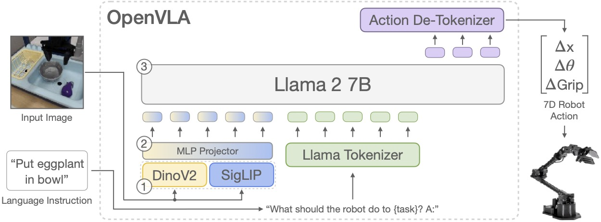

# OpenVLA / OpenVLA-OFT

[English](openvla.md)

> **类别：** Vision-Language-Action Model · [Repository](https://github.com/openvla/openvla) · [Project Page](https://openvla.github.io/) · [Paper](https://arxiv.org/abs/2406.09246) · [OpenVLA-OFT](https://openvla-oft.github.io/)

  

<em>OpenVLA 将图像与语言指令映射为 tokenized robot actions。图片来源：<a href="https://openvla.github.io/">official project page</a>。</em>

## 概览

- **定位：** 具有代表性的开放 VLA baseline，建立在 Open X-Embodiment 数据路线之上。
- **模型规模：** 旗舰版本为 7B parameters。
- **输入与输出：** 从图像和语言生成 robot action；具体 state、camera view 与 action interface 取决于 checkpoint 和训练方案。
- **动作表示：** 原始 OpenVLA 使用 discrete action tokens；OpenVLA-OFT 提供 continuous action fine-tuning 方案。

## 为什么重要

OpenVLA 公开了 7B generalist VLA、checkpoints、inference、fine-tuning、evaluation 和 serving 代码。它是研究“如何将 pretrained VLM 适配为 robot controller”以及“如何使用 Open X-Embodiment 进行大规模 robot pretraining”的重要参考。

## 架构与数据

旗舰模型基于 Prismatic-7B VLM，由 DINOv2 与 SigLIP 提供视觉特征，Llama 2 作为 language backbone。官方项目说明其使用约 97 万条 Open X-Embodiment robot episodes 进行训练，输出动作需要结合目标 robot 或 dataset 对应的 normalization statistics 还原。

整体流程可以拆为四步：

1. DINOv2 与 SigLIP 对当前 robot-camera image 进行编码。
2. Projector 将视觉特征映射到 language model 的 embedding space。
3. Llama 2 backbone 联合处理视觉表示与 natural-language instruction。
4. 预测得到的 action tokens 被 detokenize，并按照目标 robot 的统计信息执行 unnormalize。

这种设计将 robot control 转换为 next-token prediction，便于复用 pretrained VLM，但也带来 action discretization 与 control latency 的权衡。

## 适配与控制

原始仓库支持 full fine-tuning、LoRA 和 quantized LoRA。适配新 robot 或 dataset 时必须选择正确的数据标识与 action statistics，因为 normalized output 与 embodiment 强相关。仓库也提供 REST policy serving，使 inference 与 robot client 可以分开部署。

OpenVLA-OFT 是独立的 optimized fine-tuning recipe，不是原 checkpoint 的简单改名。它使用 continuous action head，并加入 action chunking 等面向控制效率的改进。因此引用结果时应同时说明 base checkpoint 与 adaptation recipe。

## 已开放内容

- MIT-licensed repository code。
- `openvla-7b` 与较早的 `openvla-v01-7b` checkpoint。
- Hugging Face 风格的 inference interface。
- LoRA、quantized LoRA、full fine-tuning、training、evaluation 与 REST serving。
- 使用 continuous actions 的 OpenVLA-OFT recipe。

## 开放性与使用边界

- Repository code 与 model weights 的 license context 并不完全相同；旗舰权重基于 Llama 2，需要同时考虑其相关条款。
- Open X-Embodiment 由多个 dataset 构成，各数据源的开放范围与 license 并不统一。
- “OpenVLA result” 过于宽泛，必须进一步说明使用的是原始方案、OFT，还是其他后续 recipe。

## 适用场景

OpenVLA 适合用来研究经典开放 VLA architecture、Open X-Embodiment pretraining，以及 7B policy 的 parameter-efficient adaptation。第一次进行低资源实验时，SmolVLA 通常门槛更低；openpi 与 GR00T 则提供了不同的 continuous-action 与 deployment 设计。

## 原始来源

- [Official repository](https://github.com/openvla/openvla)
- [Project page](https://openvla.github.io/)
- [Paper](https://arxiv.org/abs/2406.09246)
- [OpenVLA-OFT](https://openvla-oft.github.io/)
