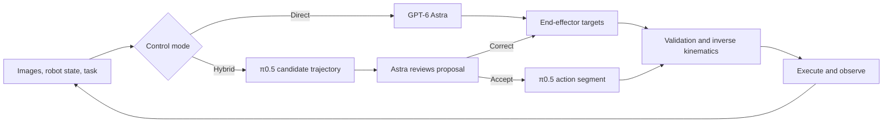

# GPT-6 Astra as an Embodied Policy

[简体中文](gpt-as-policy_ZH.md) · [Agent-Based Manipulation](README.md)

> Direct and π0.5-assisted manipulation · [Technical report and results](https://anonymous-report-421.github.io/public-website/) · [Official repository](https://github.com/anonymous-report-421/GPT-as-Policy)

*Control flow based on the [authors' technical report](https://anonymous-report-421.github.io/public-website/); the direct mode does not invoke π0.5.*

## Technical Summary

This study examines whether a general-purpose multimodal reasoning model can act as a robot policy and how its decisions change when a learned policy supplies candidate motions. It compares GPT-6 Astra direct control with a hybrid of Astra and π0.5 on selected bimanual RoboDojo tasks. The key variable is control authority: in one setting Astra produces every end-effector command; in the other it reviews a sensorimotor policy's proposal and intervenes when appropriate.

## Observations and Action Interfaces

Both systems receive the task instruction, three camera views, a 14-dimensional robot-state vector, and execution history. In the direct system, Astra emits bimanual end-effector position, orientation, and gripper targets. The controller validates the targets, applies inverse kinematics, and executes a short segment before the next observation. π0.5 is never queried in this setting.

In the hybrid system, a separate OpenPI service produces a 50-step, 14-dimensional joint-action proposal. Forward kinematics converts it into a trajectory Astra can inspect. Astra either accepts the beginning of that proposal or substitutes a short end-effector correction; the two branches are alternatives at a decision point, not simultaneous blended controls. New observations and measured robot state determine the next decision.

## Execution System

Python owns the simulator connection and checks action dimensions, coordinate frames, and target limits. The reported setup constrains each end-effector correction and recomputes inverse kinematics after actual execution feedback. The model's requested target is distinct from the robot's measured achieved pose. The agent also receives task progress and termination information; task completion is determined by the environment rather than by the model's own declaration.

This system boundary matters: success reflects the reasoning model, the π0.5 policy where present, the action contract, inverse kinematics, simulator behavior, and feedback handling together. The report's code and results include a RoboDojo integration, a separate RoboLab integration, case metadata, and rollout records. External simulator and π0.5 environments are required to run a new evaluation.

## Evaluation and Reported Results

The report evaluates ten selected RoboDojo tasks with five aligned cases per task. On these 50 cases, the hybrid succeeds in 48% and direct control in 26%. Astra corrects 14.4% of executed control steps in the hybrid; π0.5 supplies the remaining steps. The reported hybrid mean Score is 62.60. The direct mean Score of 37.81 uses the 48 episodes with available native scores, although the direct success rate uses all 50 cases. The comparison with public π0.5 results is reweighted for this task subset, not a same-seed rerun of that policy.

The results show a distinction between semantic correction and low-level trajectory generation within the selected tasks. They are not full RoboDojo leaderboard results. The simulation can pause while the agent reasons, so task success alone does not establish real-time physical control. Latency, token use, action-segment length, task selection, and controller constraints are necessary context for comparing this system with other agents or policies.

## References

- [Technical report, results, and videos](https://anonymous-report-421.github.io/public-website/)
- [Official repository](https://github.com/anonymous-report-421/GPT-as-Policy)
