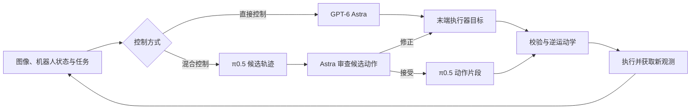

# GPT-6 Astra as an Embodied Policy

[English](gpt-as-policy.md) · [Agent 式具身操作](README_ZH.md)

> 直接控制与 π0.5 辅助控制 · [技术报告与实验结果](https://anonymous-report-421.github.io/public-website/) · [官方仓库](https://github.com/anonymous-report-421/GPT-as-Policy)

*控制流程根据[作者的技术报告](https://anonymous-report-421.github.io/public-website/)绘制；直接控制不调用 π0.5。*

## 技术概览

该研究考察通用多模态推理模型能否直接充当机器人策略，以及学习型策略提供候选动作后决策会如何变化。论文在选定的 RoboDojo 双臂任务上比较 GPT-6 Astra 直接控制与 Astra + π0.5 混合控制。核心差别是动作权限：前者的每一步末端执行器指令均由 Astra 生成；后者由 Astra 审查传感运动策略的候选轨迹，并在需要时介入。

## 观测与动作接口

两种系统都接收任务指令、三个相机视角、14 维机器人状态以及执行历史。直接控制时，Astra 生成双臂末端执行器的位置、朝向和夹爪目标。控制器校验目标、求解逆运动学、执行短动作片段，再返回新观测；此设置完全不调用 π0.5。

混合控制时，独立的 OpenPI 服务生成 50 步、每步 14 维的关节动作候选。前向运动学将其转换为 Astra 可以审查的轨迹。Astra 选择执行候选轨迹的起始部分，或以一小段末端执行器修正替代；两条分支在一次决策中互斥，不会将命令同时混合。下一轮决策依据更新后的图像和实测机器人状态作出。

## 执行系统

Python 负责仿真连接，并检查动作维度、坐标系和目标约束。报告中的系统限制每次末端修正幅度，且在获得实际执行反馈后重新计算逆运动学。模型提出的目标位置与机器人最终测得的位置必须区分。Agent 还会收到任务进度和终止信息；是否完成任务由环境判定，而非模型自行宣布。

这一系统边界很重要：实验结果同时受到推理模型、存在时的 π0.5 策略、动作接口、逆运动学、仿真环境和反馈处理影响。公开仓库包含 RoboDojo 集成、独立的 RoboLab 集成、测试用例元数据和运行记录。重新运行评测还需另行配置仿真器与 π0.5 环境。

## 评测与报告结果

报告选取十项 RoboDojo 任务，每项任务设置五个配对测试用例。在这 50 个用例中，混合系统的成功率为 48%，直接控制为 26%。混合系统中，Astra 修正了已执行控制步的 14.4%，其余步骤来自 π0.5。混合系统的平均 Score 为 62.60；直接控制的平均 Score 为 37.81，但后者只使用有原生分数记录的 48 个回合，成功率仍使用全部 50 个用例。与公开 π0.5 结果的比较按照这一任务子集重新加权，并非对该策略进行相同随机种子的重新测试。

实验说明，在所选任务中，语义层面的修正与底层轨迹生成具有不同作用。这些数字并非完整 RoboDojo 排行榜成绩。仿真可在 Agent 推理期间暂停，因此成功率本身不能证明系统具备实时物理控制能力。比较其他 Agent 或策略时，还需考虑推理延迟、token 消耗、动作片段长度、任务选择和控制器约束。

## 参考资料

- [技术报告、实验结果与视频](https://anonymous-report-421.github.io/public-website/)
- [官方仓库](https://github.com/anonymous-report-421/GPT-as-Policy)
